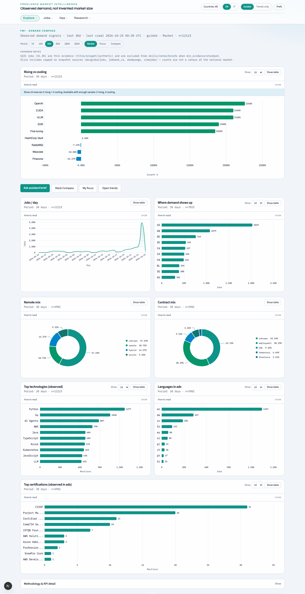
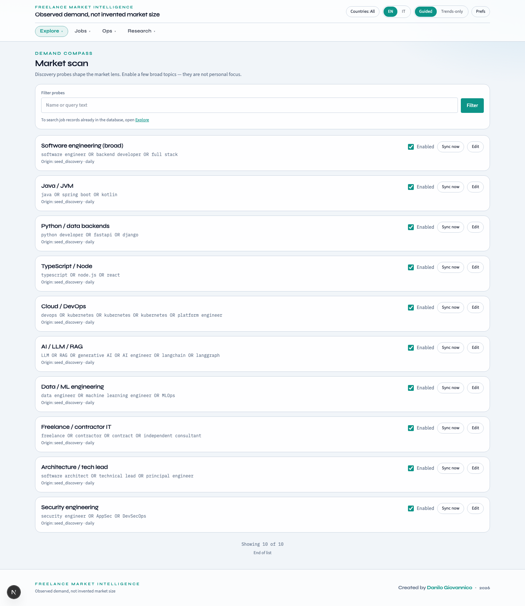
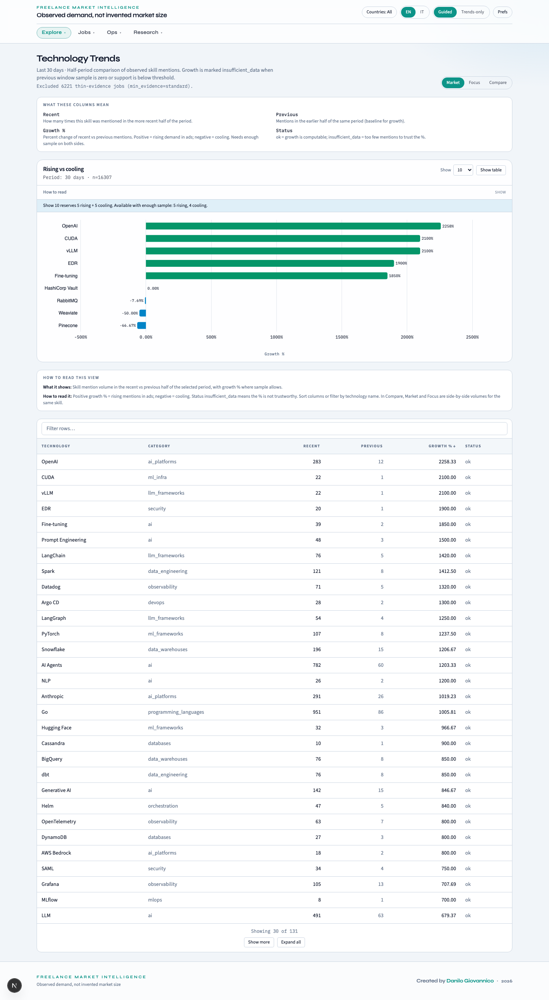
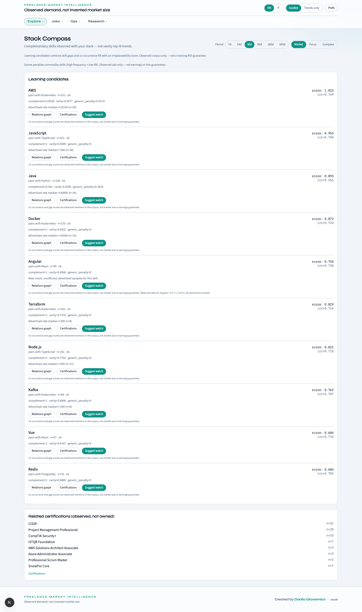
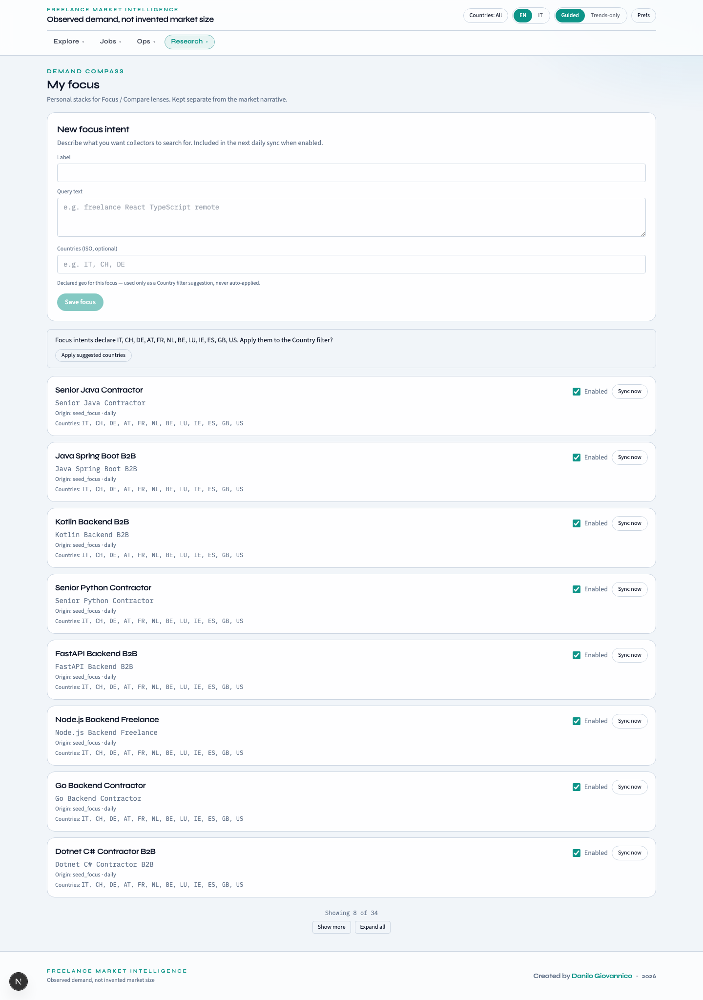
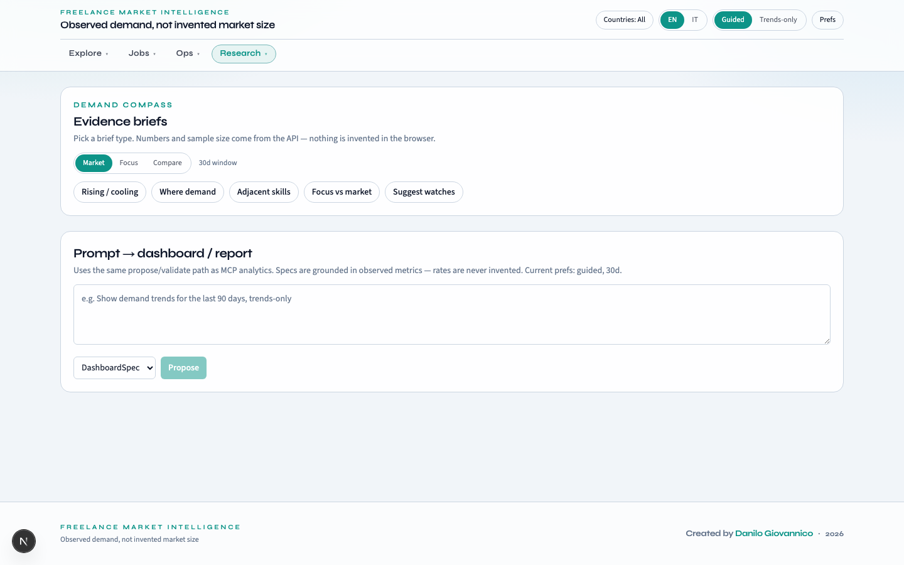
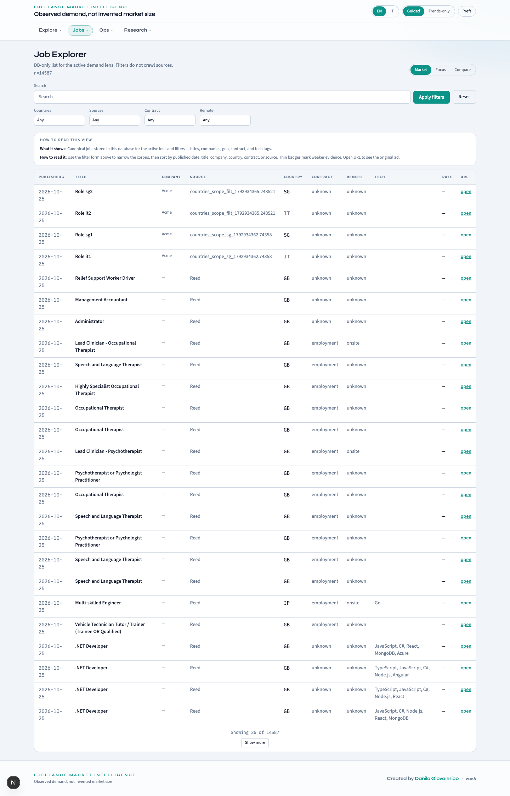
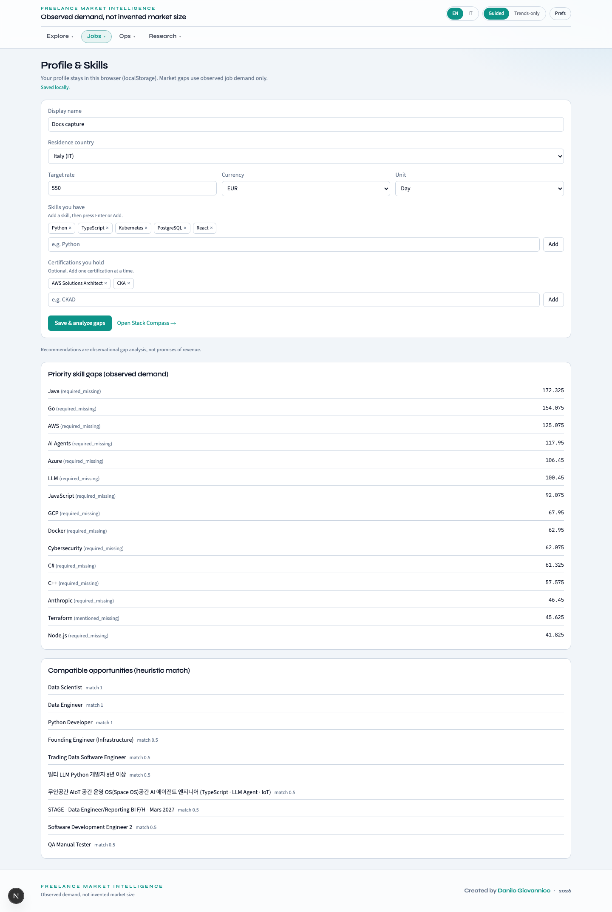
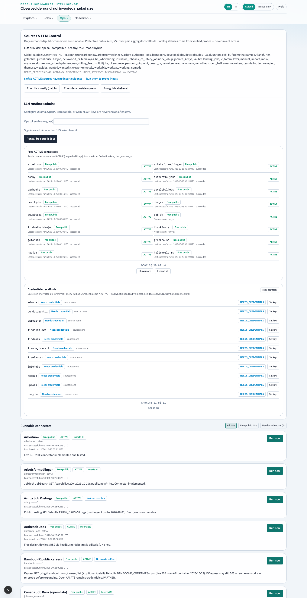
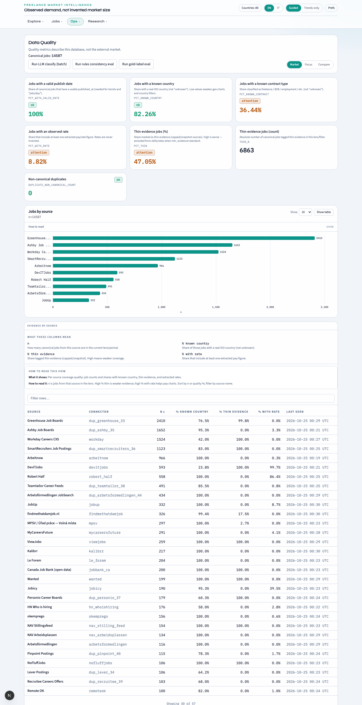

<div align="center">

# Freelance Market Intelligence

**Demand Compass** — observed IT freelance demand, not invented market size.

[](LICENSE)
[](https://github.com/dgiovannico-dev)
[](backend/requirements.txt)
[](backend/app/main.py)
[](frontend)
[](docker-compose.yml)

Collect authorized public job data → normalize → classify → explore dashboards, career tools, and research briefs — always with **sample size**, **coverage notes**, and honest empty states.

[Docs](docs/README.md) · [Visual tour](docs/manuals/VISUAL-TOUR.md) · [Architecture](docs/architecture/OVERVIEW.md) · [Local ops](docs/ops/LOCAL.md)

<br />



<sub>Executive home — rising / cooling signals with observed job counts in this database.</sub>

</div>

---

## Why it exists

Most “market reports” for freelancers mix scraped noise, paywalled estimates, and vanity totals. **FMI** does the opposite:

| Principle | What you get |
|-----------|----------------|
| **Evidence-first** | Every KPI is a count (or rate) of records **in this corpus**, never a guessed TAM. |
| **Authorized sources only** | Connectors go `ACTIVE` only when collection is legal and verifiable ([ADR-003](docs/decisions/ADR-003-authorized-connectors-only.md)). |
| **Methodology travels with the number** | Lenses (`market` / `focus` / `compare`), thin vs standard evidence, and coverage copy stay visible in the UI. |
| **Four clear zones** | Explore market signals · Research your bets · Jobs & career · Ops for corpus health. |

Built for freelancers, researchers, and operators who need a shared, auditable picture of demand.

---

## Product tour

<div align="center">

| Explore | Trends | Stack |
|:-------:|:------:|:-----:|
|  |  |  |
| Discovery probes & catalog | Rising / cooling tech | Adjacent skills for your stack |

| Focus | Assistant | Jobs |
|:-----:|:---------:|:----:|
|  |  |  |
| Personal research intents | Evidence briefs (LLM optional) | Inventory with filters |

| Profile & Learn | Sources (ops) | Quality |
|:---------------:|:-------------:|:-------:|
|  |  |  |
| Skills, gaps, study plan | Connectors & LLM admin | Coverage by source |

</div>

Prefer motion? Watch the [screen recordings](docs/manuals/VISUAL-TOUR.md) (full platform + one video per zone).

---

## What you can do

- **Explore** — Executive KPIs, market scan, explorer, trends, skills co-occurrence, rates, countries, languages, certifications, Stack Compass.
- **Research** — Focus intents, weekly report (deterministic Markdown; LLM narrative when configured), Assistant evidence briefs.
- **Jobs & career** — Job inventory, browser profile (localStorage), Learn / study advisor, applications log.
- **Ops** — Data quality, source catalog & runs, alerts; admin LLM runtime and connector credentials when OIDC `admin` (or local ops token).
- **MCP** — Schema-driven analytics over a read-only DB for agent tooling ([ADR-006](docs/decisions/ADR-006-mcp-schema-driven-analytics.md)).

---

## Stack

| Layer | Choice |
|-------|--------|
| API | Python 3.12 · FastAPI · SQLAlchemy 2 · Alembic · PostgreSQL |
| UI | Next.js (TypeScript) · Tailwind · next-intl (`en` / `it`) |
| Cache | Valkey (Redis protocol) |
| LLM (optional) | Ollama / OpenAI-compatible / Gemini — admin-configurable ([ADR-010](docs/decisions/ADR-010-admin-llm-runtime-config.md)) |
| Run | Docker Compose locally · Helm / k3s for prod-shaped deploys |
| Auth (optional) | Keycloak OIDC — roles `user` / `admin` ([ADR-009](docs/decisions/ADR-009-keycloak-identity-localstorage-profile.md)) |

Architecture diagrams: [docs/architecture/OVERVIEW.md](docs/architecture/OVERVIEW.md) · database ER: [docs/architecture/DATABASE.md](docs/architecture/DATABASE.md).

---

## Quick start

**Prerequisites:** Docker (recommended) or Python 3.12 + Node 22.23.4+.

```bash
git clone https://github.com/dgiovannico-dev/market_research.git
cd market_research
cp .env.example .env
docker compose up --build
```

| Service | URL |
|---------|-----|
| UI | http://localhost:3000 |
| API docs | http://localhost:8000/docs |
| Health | http://localhost:8000/readyz |

Relaunch + smoke (throttled; force with `COMPOSE_STACK_FORCE=1`):

```bash
./scripts/compose_stack_relaunch.sh
```

### Seed data

1. Open **Ops → Sources** and run public `ACTIVE` collectors, or  
2. Import the sample CSV:

```bash
curl -F "file=@data/samples/jobs_sample.csv" http://localhost:8000/api/v1/imports
```

Hybrid (API on host, DB in Compose) and CORS notes: [docs/ops/LOCAL.md](docs/ops/LOCAL.md).  
Local LLM on Apple Silicon: [docs/ops/LLM-LOCAL.md](docs/ops/LLM-LOCAL.md).

---

## Documentation map

| Audience | Start here |
|----------|------------|
| **See the product** | [Visual tour](docs/manuals/VISUAL-TOUR.md) → [User overview](docs/manuals/OVERVIEW.md) |
| **Engineers** | [Architecture](docs/architecture/OVERVIEW.md) → [Database](docs/architecture/DATABASE.md) → [ADRs](docs/decisions/) |
| **Operators** | [Local](docs/ops/LOCAL.md) · [Helm/k3s](docs/ops/HELM-k3s.md) · [Runbooks](docs/ops/RUNBOOKS.md) · [Release](docs/ops/RELEASE.md) |
| **Admins** | [Admin manual](docs/manuals/ADMIN.md) · [Keycloak](docs/ops/KEYCLOAK.md) |
| **Vocabulary** | [Glossary](docs/GLOSSARY.md) |

Full index: [docs/README.md](docs/README.md).

---

## Develop & verify

```bash
# Backend
cd backend && python -m venv .venv && source .venv/bin/activate
pip install -r requirements.txt
alembic upgrade head
pytest -q
./scripts/smoke_e2e.sh

# Frontend
cd frontend && npm install && npm run build
```

MCP stdio server (prefer `DATABASE_URL_READONLY`):

```bash
cd backend && source .venv/bin/activate && python -m app.mcp
```

Backup helpers: `./backend/scripts/backup_db.sh` · restore smoke in the same folder.

---

## Ethics & connectors

FMI does **not** scrape behind auth walls, CAPTCHA, or paywalls. Only authorized / public connectors become `ACTIVE`. See [ADR-003](docs/decisions/ADR-003-authorized-connectors-only.md) and the [source catalog](data/sources/catalog.json).

---

## License & authorship

**Created by [Danilo Giovannico](https://github.com/dgiovannico-dev).**

This project is **proprietary** — © 2026 Danilo Giovannico. All rights reserved.  
See [LICENSE](LICENSE). No open-source grant is implied; use or redistribution requires the author’s written permission.

---

<div align="center">
<sub>Observed demand · transparent methodology · created by Danilo Giovannico</sub>
</div>
