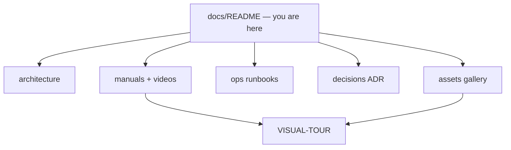

# FMI documentation

Evidence-first market intelligence for IT freelancers. Counts always mean **observed records in this database**, never invented total market size.

## Start here (pick your role)

| If you are… | Open first |
|-------------|------------|
| **New user** (want to see it work) | [manuals/VISUAL-TOUR.md](manuals/VISUAL-TOUR.md) (videos) then [manuals/OVERVIEW.md](manuals/OVERVIEW.md) |
| **Engineer** | [architecture/OVERVIEW.md](architecture/OVERVIEW.md) → [DATABASE.md](architecture/DATABASE.md) |
| **Operator / DevOps** | [ops/LOCAL.md](ops/LOCAL.md) → [RELEASE.md](ops/RELEASE.md) → [RUNBOOKS.md](ops/RUNBOOKS.md) |
| **Admin of connectors / LLM** | [manuals/ADMIN.md](manuals/ADMIN.md) + [ops/LLM-LOCAL.md](ops/LLM-LOCAL.md) + [ops/KEYCLOAK.md](ops/KEYCLOAK.md) |

Glossary of product terms: [GLOSSARY.md](GLOSSARY.md).

## Architecture

| Doc | Purpose |
|-----|---------|
| [architecture/OVERVIEW.md](architecture/OVERVIEW.md) | Containers, modules, hexagonal layers, data-flow Mermaid |
| [architecture/DATABASE.md](architecture/DATABASE.md) | Entity groups, ER diagram, evidence tiers, migrations |

## User / operator manuals (videos + screenshots)

| Manual | Zone |
|--------|------|
| [manuals/VISUAL-TOUR.md](manuals/VISUAL-TOUR.md) | Product videos (all zones) + still frames |
| [manuals/OVERVIEW.md](manuals/OVERVIEW.md) | Atlas zones, lens, prefs, auth |
| [manuals/EXPLORE.md](manuals/EXPLORE.md) | Executive → Stack / certs / trends |
| [manuals/RESEARCH.md](manuals/RESEARCH.md) | Focus, Assistant, weekly report |
| [manuals/CAREER.md](manuals/CAREER.md) | Jobs, profile, Learn, applications |
| [manuals/ADMIN.md](manuals/ADMIN.md) | Sources, quality, alerts |

Videos and screenshots: [assets/](assets/README.md) · [assets/videos/](assets/videos/README.md).

## Ops / DevOps

| Doc | Purpose |
|-----|---------|
| [ops/LOCAL.md](ops/LOCAL.md) | Hybrid vs Compose, smoke relaunch |
| [ops/LLM-LOCAL.md](ops/LLM-LOCAL.md) | Local LLM on Apple Silicon (Ollama; why not vLLM) |
| [ops/HELM-k3s.md](ops/HELM-k3s.md) | k3s + Helm workloads |
| [ops/KEYCLOAK.md](ops/KEYCLOAK.md) | OIDC sequence and roles |
| [ops/RELEASE.md](ops/RELEASE.md) | CI → image → upgrade → rollback |
| [ops/RUNBOOKS.md](ops/RUNBOOKS.md) | Symptom → fix procedures |

## Decisions (ADRs)

| ADR | Topic |
|-----|-------|
| [ADR-001](decisions/ADR-001-evidence-first-kpis.md) | Observed ≠ market size |
| [ADR-002](decisions/ADR-002-classification-modes.md) | rules / hybrid / llm |
| [ADR-003](decisions/ADR-003-authorized-connectors-only.md) | Authorized connectors only |
| [ADR-004](decisions/ADR-004-dashboard-modes.md) | Guided vs trends-only |
| [ADR-005](decisions/ADR-005-global-source-catalog.md) | Catalog as SoR |
| [ADR-006](decisions/ADR-006-mcp-schema-driven-analytics.md) | MCP schema-driven analytics |
| [ADR-007](decisions/ADR-007-query-first-sync.md) | Query-first sync / lenses |
| [ADR-008](decisions/ADR-008-hexagonal-ddd-incremental.md) | Hexagonal incremental |
| [ADR-009](decisions/ADR-009-keycloak-identity-localstorage-profile.md) | Keycloak + localStorage profile |
| [ADR-010](decisions/ADR-010-admin-llm-runtime-config.md) | Admin LLM runtime config |

## Data (not markdown)

- Source catalog: [`data/sources/catalog.json`](../data/sources/catalog.json)
- Cert taxonomy: [`data/taxonomies/certifications.json`](../data/taxonomies/certifications.json)

Repo quick start: [../README.md](../README.md)
