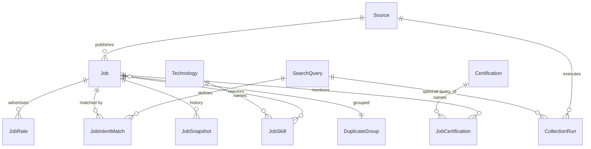
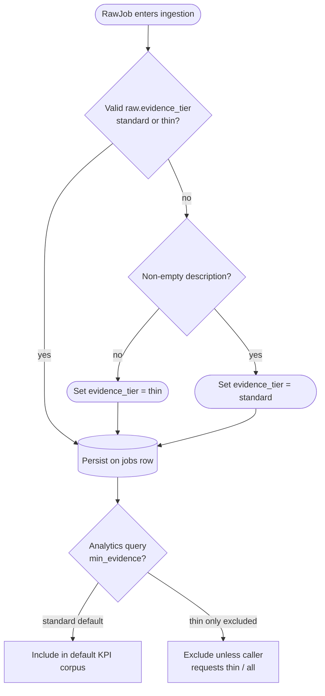

# Database architecture

**Bottom line:** PostgreSQL holds every job row, intent match, connector run, and admin setting that FMI treats as truth. ORM models live under `backend/app/storage/` (split files, aggregated in `models.py` for Alembic). KPIs count **rows here**—they are not extrapolated market totals ([ADR-001](../decisions/ADR-001-evidence-first-kpis.md); definitions in [GLOSSARY.md](../GLOSSARY.md)).

## What lives in Postgres

Think of the database in four layers:

1. **Ingestion and provenance** — which sources ran, which research intents matched which jobs.
2. **Job corpus** — canonical postings, dedup groups, snapshots, quality tier.
3. **Derived facts** — skills, rates, certifications linked to jobs with evidence metadata.
4. **Operator and UX support** — LLM admin tables, seed profiles, alerts, application outcomes.

JSON files remain authoritative for **static catalogs** where noted: source candidates (`data/sources/catalog.json`), certification taxonomy (`data/taxonomies/certifications.json`). Postgres rows are the **runtime** copy for connectors, jobs, and metrics.

## Entity groups and why they exist

### Sources and crawl

**Why:** Prove *where* data came from, enforce authorized connectors only, and budget daily sync.

| Table | Role |
|-------|------|
| `sources` | Runnable connector row (`connector_type`, `enabled`, `verification_status`) |
| `source_verifications` | Probe / verification history |
| `source_credentials` | Fernet ciphertext per `connector_key` (not a FK to `sources`) |
| `collection_runs` | Per-run counters and errors (`query_id` optional) |
| `crawler_ticks` | UTC-day idempotency for budgeted daily crawlers |

The catalog in git is the system of record for **candidates**; DB `sources` rows are seeded/synced for what actually runs ([ADR-005](../decisions/ADR-005-global-source-catalog.md), [ADR-003](../decisions/ADR-003-authorized-connectors-only.md)).

### Demand Compass (research intents)

**Why:** Separate “market scan” discovery from personal **focus** bets and drive analytics lenses.

| Table | Role |
|-------|------|
| `search_queries` | Research intents (`kind`: `discovery` \| `focus`) |
| `job_intent_matches` | Normative Job ↔ intent provenance (unique `job_id`, `query_id`) |

Lenses `market` \| `focus` \| `compare` filter KPI SQL via these matches—not via `jobs.query_id` alone ([ADR-007](../decisions/ADR-007-query-first-sync.md)).

### Jobs corpus

**Why:** One canonical row per posting (URL uniqueness when `is_canonical`), auditable history, and DSS quality gates.

| Table | Role |
|-------|------|
| `jobs` | Canonical job; contract/remote fields; `evidence_tier`; `status` |
| `job_snapshots` | Historical snapshots |
| `duplicate_groups` | Dedup grouping |

Closed statuses (`closed`, `closed_stale`, `removed_from_source`) stay in the DB for audit but are **excluded** from the decision-support corpus (`CLOSED_JOB_STATUSES` in `app.storage.enums`).

### Skills, rates, certifications

**Why:** Normalize vocabulary once, attach many-to-many facts to jobs for analytics and Stack/Learn views.

| Table | Role |
|-------|------|
| `technologies` | Normalized tech vocabulary |
| `job_skills` | Job ↔ technology + evidence kind |
| `job_rates` | Observed advertised rates |
| `certifications` / `job_certifications` | Cert taxonomy + links |
| `market_metric_daily` | Optional daily aggregates |

### LLM admin

**Why:** Operators change provider/model and prompts without redeploying ([ADR-010](../decisions/ADR-010-admin-llm-runtime-config.md)).

| Table | Role |
|-------|------|
| `llm_runtime_config` | Provider/model overrides (DB over env) |
| `llm_prompt_templates` / `llm_prompt_versions` | Prompt registry |
| `llm_admin_audit` | Admin change audit |

### Profile and outcomes (server-side)

**Why:** Seed data, alerts, and application tracking—not a multi-tenant user store.

| Table | Role |
|-------|------|
| `user_profiles` / `user_skills` | Seed / LIMIT-1 oriented; primary UI profile is **localStorage** ([ADR-009](../decisions/ADR-009-keycloak-identity-localstorage-profile.md)) |
| `application_outcomes` | Application tracker |
| `alert_rules` | Alert definitions |
| `saved_filters`, `audit_log`, legacy `llm_models` | Supporting |

## Job-centric relationships

Core foreign keys radiate from `jobs` and `sources`:

**ORM modules:** `models_core.py` (sources, jobs, intents, runs), `models_skills.py` (technologies, skills, rates, certs, snapshots), `models_llm.py`, `models_user.py`. Import surface: `backend/app/storage/models.py`.

## Evidence tier and evidence kind

Two related ideas (see [GLOSSARY.md](../GLOSSARY.md)):

- **Evidence kind** — how a *fact* was obtained (`observed`, `extracted`, `inferred`, …) on skills, rates, etc.
- **Evidence tier** — corpus *quality* on the job row: `standard` vs `thin`.

Analytics default **`min_evidence=standard`**, which drops thin rows unless callers explicitly opt in. That keeps title-only or snippet-only postings from skewing KPIs ([ADR-001](../decisions/ADR-001-evidence-first-kpis.md)).

### How `jobs.evidence_tier` is set

At ingest, `resolve_evidence_tier` in `app.ingestion.evidence_tier`:

1. Honors an explicit collector tag in `raw.evidence_tier` when valid.
2. Otherwise marks **`thin`** when description is empty/whitespace.
3. Otherwise **`standard`**.

**Operator takeaway:** Thin rows remain stored for audit and optional views; default dashboards intentionally under-count versus “everything we ever saw” so numbers stay defensible.

## Migration policy

Alembic revisions live in `backend/alembic/versions/`. Apply schema changes **forward only** in production.

1. **Generate or add a revision** when ORM models change; keep each migration focused and reviewable.
2. **Apply with** `alembic upgrade head` — Docker Compose API startup and the Helm migrate Job/initContainer run this automatically.
3. **Bootstrap vs deltas:** revision `0001` creates from `Base.metadata`; `0002`–`0012` (and later) are incremental (verification, prefs, intents, crawler ticks, URL uniqueness, evidence tier, indexes, collection summary, credentials, certifications, LLM runtime/prompts, etc.).
4. **Forward-only in production:** do not rely on `downgrade` for release rollback; pin the previous application image instead ([ops/RELEASE.md](../ops/RELEASE.md)).
5. **Destructive changes:** do not drop columns or tables without an ADR and a migration that preserves or backfills evidence users rely on.
6. **Verify locally** before merge: upgrade from empty DB and from a copy of production shape when possible; run API smoke tests.

## Operator notes

- **Read-only access for MCP:** prefer `DATABASE_URL_READONLY` (SELECT-only) when running `python -m app.mcp`.
- **Backups:** `backend/scripts/backup_db.sh`; validation via `backup_smoke.sh` / `restore_smoke.sh`.
- **Health:** `/livez` (process), `/readyz` (DB + Valkey when Redis rate-limit backend is configured).

## Related documentation

| Topic | Document |
|-------|----------|
| Containers and data flow | [OVERVIEW.md](OVERVIEW.md) |
| Ubiquitous language | [GLOSSARY.md](../GLOSSARY.md) |
| Evidence-first KPI law | [ADR-001](../decisions/ADR-001-evidence-first-kpis.md) |
| Local Postgres | [ops/LOCAL.md](../ops/LOCAL.md) |
| Release and rollback | [ops/RELEASE.md](../ops/RELEASE.md) |
| Symptom-first procedures | [ops/RUNBOOKS.md](../ops/RUNBOOKS.md) |
