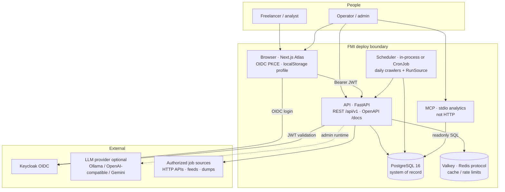
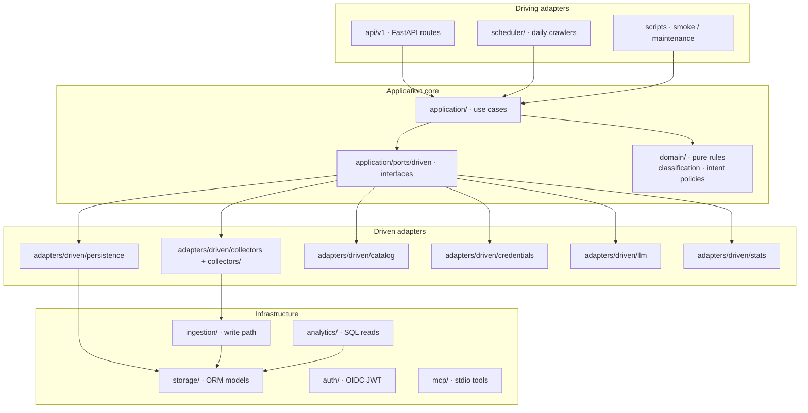
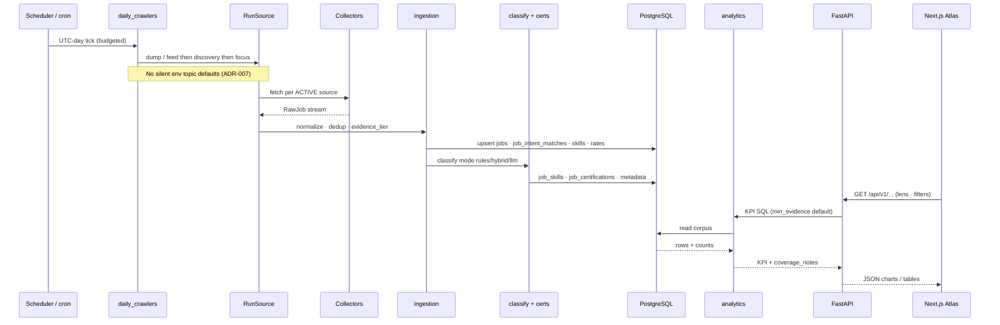
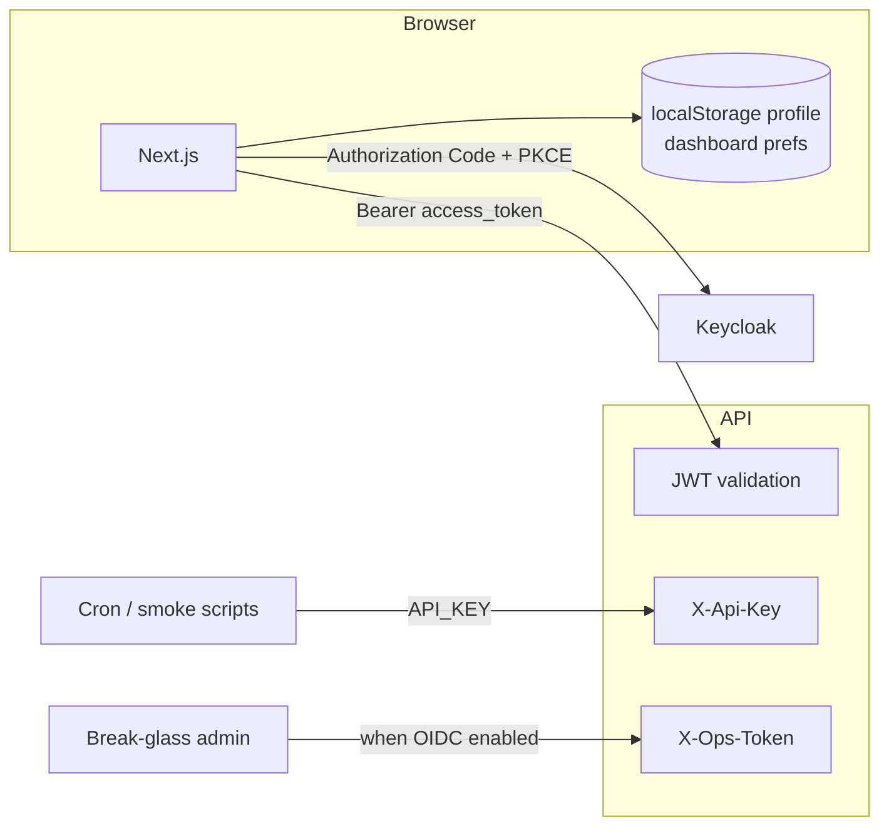

# Architecture overview

**Bottom line:** FMI is a full-stack pipeline that ingests **authorized** job listings, stores them in PostgreSQL with explicit evidence metadata, classifies skills/rates/certs, and serves **observed** KPIs to the Atlas UI and optional MCP tools. Numbers on screen are row counts in *this* database—not estimates of total market size ([ADR-001](../decisions/ADR-001-evidence-first-kpis.md)).

## Who it is for and what it solves

Freelance Market Intelligence (FMI) targets **IT freelancers and operators** who need defensible demand signals: which skills, rates, geographies, and certifications show up in real postings they can cite. The product problem is not “predict the market” but **collect, normalize, and explain what was actually observed** from approved connectors, then slice that corpus by research intents (Demand Compass) and personal focus. The Next.js Atlas app (EN/IT) is grouped into four nav zones—Explore, Jobs, Ops, Research—defined in `frontend/lib/navZones.ts`; see [manuals/OVERVIEW.md](../manuals/OVERVIEW.md) for route-level guidance.

## System containers (C4-style)

Runtime pieces and trust boundaries:



| Container | Role |
|-----------|------|
| Browser (Next.js) | Atlas UI, dashboard prefs, profile in **localStorage** ([ADR-009](../decisions/ADR-009-keycloak-identity-localstorage-profile.md)) |
| API (FastAPI) | HTTP drivers, analytics reads, ops, assistant hooks |
| PostgreSQL 16 | Jobs, intents, sources, LLM admin, outcomes |
| Valkey | `REDIS_URL` cache and rate limiting when configured |
| Keycloak | OIDC IdP; roles `user` / `admin` — [ops/KEYCLOAK.md](../ops/KEYCLOAK.md) |
| LLM (optional) | Classification refine, briefs, study advisor; DB-backed runtime ([ADR-010](../decisions/ADR-010-admin-llm-runtime-config.md)) |
| MCP (stdio) | Schema-driven metrics/briefs for agents — not exposed as HTTP ([ADR-006](../decisions/ADR-006-mcp-schema-driven-analytics.md)) |

**Run locally:** Docker Compose — [ops/LOCAL.md](../ops/LOCAL.md). **Production-shaped:** Helm on k3s — [ops/HELM-k3s.md](../ops/HELM-k3s.md). **Incidents:** [ops/RUNBOOKS.md](../ops/RUNBOOKS.md). **Releases:** [ops/RELEASE.md](../ops/RELEASE.md).

## Product modules

Backend and UI features map to these bounded capabilities (names match code and docs):

| Module | Responsibility |
|--------|----------------|
| **sources** | Global catalog (`data/sources/catalog.json`); only **ACTIVE** connectors ingest ([ADR-003](../decisions/ADR-003-authorized-connectors-only.md), [ADR-005](../decisions/ADR-005-global-source-catalog.md)) |
| **research-intents** | Demand Compass: **discovery** and **focus** `SearchQuery` rows; lenses and provenance ([ADR-007](../decisions/ADR-007-query-first-sync.md)) |
| **ingest** | Collectors → `RawJob` → upsert jobs, skills, rates, certs |
| **classify** | Modes `rules` \| `hybrid` \| `llm`; evidence kinds on facts ([ADR-002](../decisions/ADR-002-classification-modes.md)) |
| **analytics** | SQL read adapters (summary, trends, rates, geo, co-occurrence, certs) |
| **dashboard** | Signal desk UI; **guided** vs **trends_only** presentation ([ADR-004](../decisions/ADR-004-dashboard-modes.md)) |
| **profile-outcomes** | Applications, alerts, weekly report; server profile is seed-oriented |
| **stack-compass** | Learning candidates / irreplaceability from profile + market |
| **study-advisor** | Evidence-grounded study plans, busy-slot / ICS week calendar, WLB distribution (optional LLM refine) |
| **certifications** | Taxonomy + job↔cert KPIs |
| **ops** | Scheduler, credentials, LLM runtime/prompts, metrics |
| **mcp-analytics** | Stdio MCP for schema/metrics/briefs |

## Hexagonal layout (backend)

Adoption is **incremental and ports-first** ([ADR-008](../decisions/ADR-008-hexagonal-ddd-incremental.md)). `bootstrap.py` builds `AppContainer`: settings, SQLAlchemy sessions (including optional readonly URL), and driven adapters (collectors, catalog, credentials, job write, LLM factory, external stats). Web, scheduler, MCP, and scripts share this composition root instead of opening ad hoc DB connections.



**Layout on disk:**

```
backend/app/
  api/v1/           # HTTP drivers
  application/      # use cases + driven ports
  adapters/driven/  # SQLAlchemy, collectors registry, catalog, LLM, credentials
  domain/           # thin pure rules
  collectors/       # connector adapters → RawJob
  ingestion/        # write path into Postgres
  analytics/        # SQL read adapters (CQRS-light)
  storage/          # ORM models (split modules; barrel models.py)
  bootstrap.py      # AppContainer composition root
  auth/             # OIDC JWT
  mcp/, scheduler/, reports/
```

**Hard rules:** one crawl path (`RunSource` for HTTP run and daily tick); analytics stay SQL read adapters; HTTP must not import `app.mcp`.

## End-to-end flow (tick → UI)

Scheduled work and user reads share the same corpus. Analytics never invent rows—they query Postgres with lens filters (`market` \| `focus` \| `compare`).



**Stages in plain language:**

1. **Tick** — Dump/feed collectors run first, then discovery watchlist, then focus intents. Intents drive *what* to crawl; env does not silently substitute topics ([ADR-007](../decisions/ADR-007-query-first-sync.md)).
2. **Ingest** — Normalize URLs and text, resolve duplicate groups, set `evidence_tier`, attach **`job_intent_matches`** (normative provenance; `jobs.query_id` is supporting).
3. **Classify** — Rules, hybrid, or LLM paths attach technologies, contract/remote evidence, certification links.
4. **Read** — Dashboards, assistant, and MCP query the same tables with lens and quality gates ([DATABASE.md](DATABASE.md)).

## Auth and actors

Identity is split: **Keycloak** for who can call the API; **localStorage** for end-user career profile data on the device ([ADR-009](../decisions/ADR-009-keycloak-identity-localstorage-profile.md)).



| Actor | Mechanism | Typical use |
|-------|-----------|-------------|
| Browser user | OIDC Bearer (`user` or `admin`) | Atlas UI, authenticated API |
| Cron / smoke | `X-Api-Key` (`API_KEY`) | Scheduled crawls, CI smoke |
| Break-glass admin | `X-Ops-Token` when OIDC is on | Emergency ops without IdP |
| End-user profile | **localStorage** (not server multi-tenant identity) | Skills, prefs, applications UX |

## Architecture decision index

| ADR | One-line summary |
|-----|------------------|
| [001](../decisions/ADR-001-evidence-first-kpis.md) | Observed row counts ≠ total market size |
| [002](../decisions/ADR-002-classification-modes.md) | `rules` / `hybrid` / `llm` classification |
| [003](../decisions/ADR-003-authorized-connectors-only.md) | No ToS bypass; ACTIVE gate for ingest |
| [004](../decisions/ADR-004-dashboard-modes.md) | Guided vs trends-only presentation |
| [005](../decisions/ADR-005-global-source-catalog.md) | JSON catalog is SoR for source candidates |
| [006](../decisions/ADR-006-mcp-schema-driven-analytics.md) | Validated specs, not free SQL in UI |
| [007](../decisions/ADR-007-query-first-sync.md) | Discovery + focus intents; analytics lenses |
| [008](../decisions/ADR-008-hexagonal-ddd-incremental.md) | Hexagonal ports/adapters, incremental |
| [009](../decisions/ADR-009-keycloak-identity-localstorage-profile.md) | Keycloak + localStorage profile |
| [010](../decisions/ADR-010-admin-llm-runtime-config.md) | DB LLM runtime + prompt registry |

Ubiquitous terms: [GLOSSARY.md](../GLOSSARY.md).

## Related documentation

| Topic | Document |
|-------|----------|
| Schema, tiers, migrations | [DATABASE.md](DATABASE.md) |
| Doc hub | [README.md](../README.md) |
| Using the app | [manuals/OVERVIEW.md](../manuals/OVERVIEW.md), [EXPLORE](../manuals/EXPLORE.md), [CAREER](../manuals/CAREER.md), [RESEARCH](../manuals/RESEARCH.md), [ADMIN](../manuals/ADMIN.md) |
| Local stack | [ops/LOCAL.md](../ops/LOCAL.md) |
| Kubernetes deploy | [ops/HELM-k3s.md](../ops/HELM-k3s.md) |
| OIDC setup | [ops/KEYCLOAK.md](../ops/KEYCLOAK.md) |
