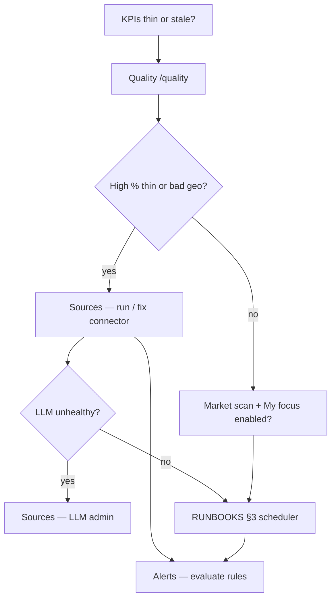

# Ops zone — admin & operators

**Who should read this:** Operators and **admin** users responsible for corpus health, connector runs, credentials, LLM runtime settings, and alert verification—after you understand evidence-first KPIs in [OVERVIEW.md](./OVERVIEW.md).

**What you will learn:** What each Ops route shows, who can change secrets, how manual runs relate to the daily scheduler, and when to escalate to runbooks.

The **Ops** zone routes from [navZones.ts](../../frontend/lib/navZones.ts):

| Path | Role |
|------|------|
| `/quality` | Read-only health dashboards (+ LLM status shortcuts) |
| `/sources` | Run connectors, catalog, credentials, LLM admin |
| `/alerts` | Rule list + manual evaluate |

**Deep production procedures:** [../ops/RUNBOOKS.md](../ops/RUNBOOKS.md) (scheduler, deploy, incidents). **Local dev:** [../ops/LOCAL.md](../ops/LOCAL.md).

---

## Operator decision flow

---

## Roles and credentials

| Role / secret | Capability |
|---------------|------------|
| **OIDC `user`** | Standard app use; not sufficient for credential PUT/DELETE |
| **OIDC `admin`** | Connector credential editor, admin LLM settings (Bearer JWT) |
| **`X-Ops-Token`** | Break-glass when OIDC off or documented fallback (`OPS_API_TOKEN`) |
| **`X-API-Key`** | Machine clients (cron, smoke)—never embed in the browser |

**UI visibility:** with `OIDC_ENABLED=true`, the LLM admin panel and credential editor on Sources render **only** for realm role **`admin`**. Non-admin users do not see those sections (API still returns 403 if called). With OIDC off (local Compose), the panels stay visible and use **`OPS_API_TOKEN`** / ops-token field for mutations.

Frontend helpers: `canSeeAdminConfig` (show panels), `canEditCredentials` / `canEditLlm` (mutation headers).

When `OIDC_ENABLED=true`, empty API key alone is **not** enough for browser admin actions—sign in as admin; break-glass `X-Ops-Token` remains for curl/automation (ADR-009). Realm setup: [../ops/KEYCLOAK.md](../ops/KEYCLOAK.md).

---

## Quality (`/quality`)

**Purpose:** **Read-only** observability of corpus quality—metrics, by-source tables, catalog cross-checks, thin-share warnings—scoped by lens and country like other analytics.

### What you'll see

- Lens toggle **market | focus | compare** (same slices as Explore).
- Metric legend: `% thin`, `% known country`, `% with rate`, duplicate counts, etc.
- Sortable **by source** table—connector-level thin share and extraction quality.
- **Quality catalog** table aligning taxonomy/catalog entries with ingestion expectations.
- **LlmOpsButtons** for quick LLM health probes—full configuration on **Sources**.

### How to use

1. Select lens and countries to match the user report (“market looks empty in DE”).
2. Sort **by source** to find connectors with high thin share or weak geo/rate extraction.
3. Use catalog table for taxonomy alignment audits.
4. Escalate to **Sources** for runs and credentials; do not expect writes on this page.

### Common pitfalls

- Trying to “fix” jobs from Quality—it does not mutate the corpus.
- Ignoring lens—**focus** thinness may be intent/sync issue, not connector failure.
- Skipping LLM health when briefs fail—classification and briefs share runtime config ([ADR-010](../decisions/ADR-010-admin-llm-runtime-config.md) when present).

Treat this page as the first stop when KPIs look “too thin” or country coverage collapses. User impact: [EXPLORE.md](./EXPLORE.md).

---

## Sources (`/sources`)

**Purpose:** Operator control plane for ingestion—status, manual runs, credential management, catalog browser, LLM ops panel.

### What you'll see

**Summary card**

- LLM provider, health, classification mode.
- **Catalog line** — connector counts by status from catalog summary API.
- **ACTIVE** connectors without insert evidence flagged (“need run”) vs all ACTIVE having inserts.

**Runnable connectors panel**

- Per-source run actions, last success/error, insert evidence flags.

**Credentialed connectors** (admin)

- Field schema fetch, PUT secrets, DELETE credentials.

**Catalog browser**

- Search/filter full connector catalog—in-page filters (not global country chrome).

**LLM admin panel**

- **LlmOpsButtons** — operational toggles/tests for admins.
- **LlmAdminPanel** — runtime prompt/model settings; site-wide effect on classification and briefs.

### How to use

1. Start from summary: LLM healthy? ACTIVE connectors have insert evidence?
2. **Run free sources** — batch trigger for runnable, enabled connectors (respects credentialed scaffold flags).
3. Use per-connector run for backfill or debugging—**daily scheduler** remains norm (`POST /scheduler/run` via cron; ADR-007). Manual runs: [../ops/RUNBOOKS.md](../ops/RUNBOOKS.md) §3.
4. **Credentials:** admin JWT or **X-Ops-Token** only; never expose secrets in tickets or commits.
5. **Catalog browser:** alignment audits with [../ops/RUNBOOKS.md](../ops/RUNBOOKS.md) connector sections.
6. **LLM admin:** change prompts/models deliberately; smoke Assistant and classification after changes.

### Common pitfalls

- Running connectors repeatedly instead of fixing credentials or catalog **ACTIVE** alignment.
- Embedding **API_KEY** in browser devtools—machine secret only.
- Expecting end users to manage credentialed connectors—admin-only (ADR-009).

---

## Alerts (`/alerts`)

**Purpose:** Inspect alert rules and **evaluate** them on demand—surfaces fired evidence without requiring a full scheduler cycle.

### What you'll see

- Listed rules and recent state from `GET /api/v1/alerts`.
- **Evaluate** control (`EvaluateAlertsButton`) posting to `POST /api/v1/alerts/evaluate`.

### How to use

1. Review rules and recent evaluation state.
2. Click **Evaluate** after ingestion fixes or rule changes—safe on empty rules (structured empty result).
3. Tie findings back to **Quality** (data gaps) or **Sources** (connector failures).

### Common pitfalls

- Assuming evaluate replaces scheduled evaluation—scheduler still runs in production.
- Treating alerts as per-OIDC-user notifications—profile assumptions match Applications (ADR-009).

---

## Operator checklist

1. **Quality** — lens + countries sane? `% thin` elevated for a source?
2. **Sources** — ACTIVE connectors have insert evidence? LLM healthy?
3. **Market scan / Focus** — enough discovery probes enabled? (user-facing but ops-relevant; [EXPLORE.md](./EXPLORE.md), [RESEARCH.md](./RESEARCH.md))
4. **Alerts** — evaluate after ingestion fixes
5. **[RUNBOOKS](../ops/RUNBOOKS.md)** — scheduler tick, migrations, Keycloak, compose relaunch

Compose stack health: [../ops/RUNBOOKS.md](../ops/RUNBOOKS.md) §1; local `.env`: [../ops/LOCAL.md](../ops/LOCAL.md).

---

## Security reminders

- Do not commit `.env` secrets; rotate ops token and API key on compromise.
- Credential PUT/DELETE audit trails belong in your deployment logging—FMI stores secrets server-side only.
- Browser profile and applications remain local/legacy profile scoped—do not treat Alerts as multi-tenant user data (ADR-009).

---

## Related docs

- [OVERVIEW.md](./OVERVIEW.md) — auth matrix, evidence-first KPIs
- [EXPLORE.md](./EXPLORE.md) — how thin/standard affects dashboards
- [RESEARCH.md](./RESEARCH.md) — discovery/focus sync model
- [../decisions/ADR-001-evidence-first-kpis.md](../decisions/ADR-001-evidence-first-kpis.md)
- [../decisions/ADR-003-authorized-connectors-only.md](../decisions/ADR-003-authorized-connectors-only.md)
- [../decisions/ADR-007-query-first-sync.md](../decisions/ADR-007-query-first-sync.md)
- [../decisions/ADR-009-keycloak-identity-localstorage-profile.md](../decisions/ADR-009-keycloak-identity-localstorage-profile.md)
