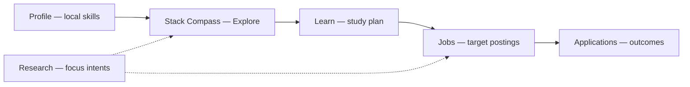
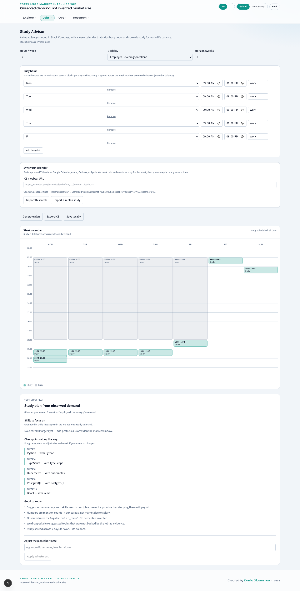

# Jobs zone — career workflows

**Who should read this:** Freelancers using FMI day to day—browsing stored postings, keeping a **local** skill profile, building a **study plan**, and tracking **application** outcomes.

**What you will learn:** How Jobs differs from Explore analytics, where your data lives (localStorage vs server), and a practical workflow from Profile → Stack → Learn → Applications.

The **Jobs** zone (nav label “Jobs”) groups career operations. Routes from [navZones.ts](../../frontend/lib/navZones.ts):

| Path | Purpose |
|------|---------|
| `/jobs` | Job inventory |
| `/profile` | Local profile & gaps |
| `/learn` | Study Advisor |
| `/applications` | Applications tracker |

Locale prefix applies (`/en/jobs`, `/it/profile`, etc.).

---

## Recommended workflow

Keep **discovery** and **focus** intents updated in [RESEARCH.md](./RESEARCH.md) so Explore lenses reflect the markets you chase.

---

## Jobs (`/jobs`)

**Purpose:** Searchable, filterable list of **canonical jobs** in the database—evidence tier, source, geography, and links to originals.

### What you'll see

- In-page filters: text, country, contract, source, thin/standard where offered.
- Paginated rows with badges for evidence tier and connector source.
- No global chrome country control on this path.

### How to use

1. Use **in-page filters**—Jobs does not use the global chrome country control ([OVERVIEW.md](./OVERVIEW.md)).
2. Open external URLs from rows for verification; respect **thin** badges as lower-confidence records.
3. Cross-check with Explore analytics: list counts may exceed KPI denominators when thin rows are excluded from aggregates.

### Common pitfalls

- Applying Executive country filter and expecting Jobs to match—it will not.
- Treating every row as input to skill/rate KPIs—aggregates often use `min_evidence=standard`.

---

## Profile (`/profile`)

**Purpose:** **Local-first** persona snapshot (ADR-009)—skills and certifications in browser `localStorage` (`fmi:userProfile:v1`), optional sync of skills into dashboard prefs (`focus_technologies`).

### What you'll see

- Fields for comma-separated **skills** and **certifications**.
- Save hint for localStorage persistence.
- **Analyze** action posting owned skills to skill-gap and recommendation endpoints.
- Guided disclaimers on gaps; trends_only may suppress heavy recommendation panels on other dashboards but Profile can still analyze on demand.

### How to use

1. Enter skills and certifications; save to localStorage.
2. Run **Analyze** for skill-gap and positioning recommendations—no persistent server profile per OIDC user in v1.
3. Follow links to **Stack Compass** and **Learn** once skills are saved.

### Common pitfalls

- Clearing site data wipes your profile—OIDC login does not back up this blob today.
- Expecting certs on Profile to auto-update **Certifications** Explore page—that page reads the **corpus**, not your local list.
- Forgetting to re-analyze after a major skill list edit before opening Stack.

---

## Learn — Study Advisor (`/learn`)

**Purpose:** Evidence-backed **study plans** from your local skills and market signals, with a **Google-style week calendar** that skips busy hours and spreads study across the week for work–life balance.

### What you'll see

- Form: hours per week, modality (`employed_part_time`, `freelance_full_time`, `intensive`), horizon weeks.
- **Busy hours** editor — multiple blocks per day (work, calls, etc.); stored in `fmi:studyBusySlots:v1`.
- **Sync your calendar** — paste a private **ICS / webcal** URL (Google Calendar secret address, Aruba, Outlook, Apple). The API imports this week’s events as busy slots (timezone from your browser). **Import & replan study** syncs then regenerates the plan.
- **Week calendar** — hour × day grid with busy (grey) and study (signal) blocks; study load aims at all seven days when free windows exist.
- Human-readable plan card: focus skills, weekly checkpoints, plain-language notes (no raw `source=llm` chrome).
- Adjust note, local persist (`fmi:studyPlan:v1`), optional **ICS export** of study blocks.
- **Proposed watches** when returned—same accept flow as Assistant.

### How to use

1. Ensure **Profile** skills are set; Learn waits for hydrated profile and prefs.
2. Mark busy hours manually **or** paste an ICS URL → **Import this week** (or **Import & replan study** each Monday).
3. Choose hours, modality, and horizon; **Generate plan**.
4. Read the week calendar and the plan card; **Adjust** with a short note if needed (LLM refine when configured).
5. **Persist** locally and/or **Export ICS** so study blocks land in your calendar.
6. Review proposed watches—accept explicitly ([RESEARCH.md](./RESEARCH.md)).

### Common pitfalls

- Generating before Profile hydrates—wait for skills to load or refresh Profile.
- Using a **public** calendar URL that omits private events—prefer the secret iCal address.
- Pasting an ICS URL that the server cannot fetch (private network / blocked host)—use a cloud calendar publish URL.
- Treating the plan as certification advice—it is evidence-linked study sequencing, not vendor endorsement.
- Ignoring proposed watches that would improve **focus** lens coverage for your goals.

Stack Compass **learning candidates** are the discovery entry; Learn is the structured weekly plan layer ([EXPLORE.md](./EXPLORE.md) — Stack).

**API:** `POST /api/v1/profile/study-advice/plan` (busy_slots), `POST /api/v1/profile/study-advice/calendar-busy` (ics_url + timezone).

---

## Applications (`/applications`)

**Purpose:** Pipeline tracker for applications and outcomes—create rows, list history, view summary metrics.

### What you'll see

- Form: job reference, dates, channel, rates, response/interview flags, outcome, rejection reason when known.
- Summary header with pipeline counts from server aggregation.
- Alert banners on API failures.

### How to use

1. Submit the form when you apply or receive outcomes.
2. Monitor pipeline counts in the summary header.
3. Use for personal accountability—not ATS integration.

### Common pitfalls (limits)

Per ADR-009:

- Applications bind to a **single server `UserProfile` row** (LIMIT-1 legacy path), **not** to Keycloak user id.
- All browser sessions on that deployment share the same application list unless multi-user profile work lands later.
- OIDC **user** role does **not** isolate application data—this is not a per-user cloud tracker.
- For portable tracking, export or mirror data externally until profile sync exists.

Alerts and weekly report share similar server profile assumptions—see [ADMIN.md](./ADMIN.md) and [RESEARCH.md](./RESEARCH.md).

---

## How Jobs zone interacts with Explore and Research

| You want… | Start here | Then |
|-----------|------------|------|
| Skills ranked in the market | [EXPLORE.md](./EXPLORE.md) — Skills / Trends | Profile + Stack for *your* gap |
| Postings that match a technology | Jobs text filter or Explorer | Lens **focus** if tied to an intent |
| A weekly learning rhythm | Learn calendar sync + ICS export | Stack candidates for *what* to learn |
| Proof your focus bet collects ads | [RESEARCH.md](./RESEARCH.md) — My focus | Jobs or Explorer with focus lens |

The Jobs zone never replaces analytics—it complements them with **inventory**, **local persona**, **planning**, and **outcome tracking**.

---

## Auth notes

- Browse **Jobs** and edit **Profile** locally without login in dev; production may require OIDC for API writes.
- Applications POST/GET use backend profile endpoints—ensure API reachability.

Auth matrix: [OVERVIEW.md](./OVERVIEW.md).

---

## Troubleshooting (user-facing)

| Symptom | Likely cause | What to do |
|---------|--------------|------------|
| Profile analysis empty | Skills not saved or API down | Save Profile; check network / [../ops/RUNBOOKS.md](../ops/RUNBOOKS.md) §1 |
| Learn stuck loading | Profile not hydrated | Reload; open Profile first |
| Calendar sync fails | Bad ICS URL / SSRF block / fetch error | Use HTTPS secret iCal link; check API `502 ics_fetch_failed` |
| Study only on weekends | Too many weekday busy blocks | Free evenings or lower hours/week; check week calendar |
| Applications list empty | Shared server profile unused yet | Submit first row; not a per-login account |
| Stack shows no candidates | Empty profile or thin corpus | Add skills; check Quality / Market scan |

---

## Related docs

- [EXPLORE.md](./EXPLORE.md) — Stack Compass, rates, relations, certifications
- [RESEARCH.md](./RESEARCH.md) — focus intents, Assistant watches
- [../decisions/ADR-009-keycloak-identity-localstorage-profile.md](../decisions/ADR-009-keycloak-identity-localstorage-profile.md)
- [../ops/RUNBOOKS.md](../ops/RUNBOOKS.md) — API readiness if Applications fail to load
