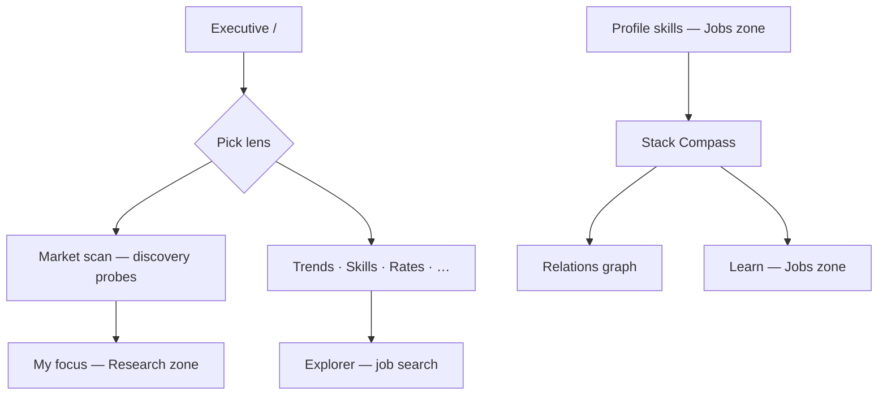
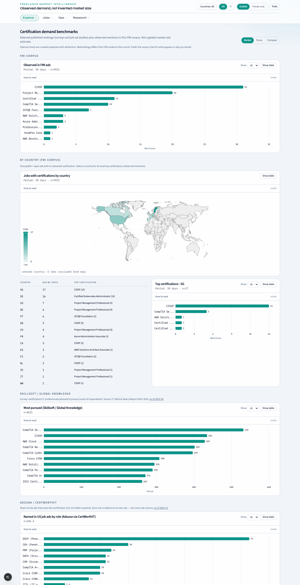

# Explore zone — market intelligence desk

**Who should read this:** Freelancers and researchers who need to read **observed** demand signals—trends, skills, rates, geography, certifications, and how their local skill stack compares to the corpus.

**What you will learn:** How each Explore route works, which global controls apply, where screenshots match the UI, and how to avoid misreading thin samples or mixing lenses.

The **Explore** zone is the market intelligence desk. All routes live under your locale prefix (for example `/en/trends`). Nav order follows [navZones.ts](../../frontend/lib/navZones.ts).

**Shared controls on most pages:**

- **Lens** — `market` | `focus` | `compare` ([OVERVIEW.md](./OVERVIEW.md)).
- **Period** — rolling window from dashboard prefs (default 30 days).
- **Country filter** — ISO codes on `ANALYTICS_COUNTRY_PATHS`; persisted in prefs.
- **View mode** — guided shows evidence copy; trends_only keeps charts lean.

Counts are **observed jobs in the database** (ADR-001). Watch for **thin evidence** badges and coverage banners when sample size is small.

---

## Explore user journey

---

## Executive (`/`)

**Purpose:** Chart-forward landing dashboard—top KPIs, rising/cooling signals, and customizable widgets.

### What you'll see

- Lens, country, and period context at the top of the analytics chrome.
- KPI cards and charts scoped to the filtered corpus.
- Widget visibility driven by dashboard prefs (`visible_widgets`, presets).

### How to use

1. Pick lens and countries to match the question (whole market vs your focus bets).
2. In **guided** mode, read coverage notes and `n=` sample sizes before interpreting growth.
3. Use links from widgets to drill into Trends, Skills, or Relations.

### Common pitfalls

- Interpreting growth when the UI shows `insufficient_data`—widen period or enable more discovery probes.
- Expecting Executive country selection to filter **Explorer** or **Jobs**—those pages filter in-page.

---

## Market scan (`/market-scan`)

**Purpose:** Manage **discovery** research intents—the transparent market-radar probes from the versioned watchlist (ADR-007). Not hidden env configuration; you can enable, disable, and sync probes.

### What you'll see

- List of discovery intents with enable/disable and per-card **Sync**.
- Local probe search when the list is long.
- **Discovery coverage warnings** when too many probes are disabled (market lens may go thin).

### How to use

1. Review the probe list; filter with probe search if needed.
2. Toggle intents on/off; use **Sync** on a card for a manual refresh (daily scheduler is the norm).
3. Pair with **My focus** ([RESEARCH.md](./RESEARCH.md))—discovery feeds the **market** lens only.

### Common pitfalls

- Disabling most discovery probes then wondering why **market** KPIs collapsed—check warnings on this page.
- Confusing discovery intents with **focus** intents (managed on `/focus`).

---

## Explorer (`/explorer`)

**Purpose:** Interactive job search over the stored corpus—DB-first explore with optional refresh, lens-aware filtering, and paginated results.

### What you'll see

- Search form: query text, lens, optional focus `query_id`.
- In-page country filters (Explorer does **not** use the global chrome country control).
- Rows with evidence tier, source, geo, and links to originals.

### How to use

1. Set query text, lens, and optional focus `query_id`.
2. Use in-page country filters.
3. Open job URLs from rows for primary sources; treat **thin** badges as lower-confidence evidence.

### Common pitfalls

- Assuming list counts equal skill/rate KPI denominators—KPIs often exclude thin rows by default.
- Forgetting **compare** lens behavior when both corpora are empty on one side.

---

## Trends (`/trends`)

**Purpose:** Technology demand over time—rising and cooling stacks; compare mode when lens is `compare`.

### What you'll see

- Bar or split layouts for rising/cooling technologies (10 vs 30 item views where offered).
- Separate market vs focus sample counts in **compare** mode.
- Chart guides in **guided** mode.

### How to use

1. Select lens; in compare, read both sides’ sample counts.
2. Use chart guides in guided mode for bar direction and layout.
3. If growth shows `insufficient_data`, widen period or countries—or enable more discovery probes.

### Common pitfalls

- Reading “cooling” as proof of market decline—it reflects **this corpus** in the selected window.
- Mixing countries that have very different posting volumes without checking **Countries** page first.

---

## Skills (`/skills`)

**Purpose:** Skill frequency and ranking in the filtered corpus (`min_evidence=standard` by default).

### What you'll see

- Sortable skill tables and charts for the active lens/country/period.
- Footnotes on excluded thin counts when present.

### How to use

1. Sort and scan top skills for your lens/country/period.
2. Note excluded thin count in footnotes.
3. Jump to Relations or Stack from related UI links when exploring adjacency.

### Common pitfalls

- Equating rank #1 with “most in-demand globally”—only in **your filtered observed set**.

---

## Relations (`/relations`)

**Purpose:** Co-occurrence and graph views—how technologies and skills appear together.

### What you'll see

- Heatmap and/or graph views seeded from a technology (`?view=graph&seed=...` from Stack Compass).
- Intensity as **joint counts**, not market share.

### How to use

1. Start from a seed technology (often linked from Stack).
2. Read heatmap intensity as co-occurrence counts.
3. Prefer standard evidence; thin cells stay de-emphasized in guided copy.

### Common pitfalls

- Inferring causal “requires X” from co-occurrence alone.

---

## Rates (`/rates`)

**Purpose:** Observed rate mentions where extraction succeeded—medians and distributions by technology/seniority where sample allows.

### What you'll see

- Series labeled by unit (day vs hour) where extraction succeeded.
- Gaps shown as **insufficient_data**, not zero pay.

### How to use

1. Compare series only at matching units.
2. Treat missing medians as insufficient data, not zero compensation.
3. Use lens/country filters to avoid mixing incompatible markets.

### Common pitfalls

- Averaging mentally across countries with different currency and contract norms.

---

## Countries (`/countries`)

**Purpose:** Geographic breakdown of observed jobs—volumes and coverage notes per country.

### What you'll see

- Volume breakdown and coverage notes when geo attribution is incomplete.

### How to use

1. Identify where your filtered corpus is concentrated.
2. Apply country filter elsewhere for deep dives on selected codes.
3. Read coverage notes when geo is partial.

### Common pitfalls

- Selecting a rare country on Executive then seeing empty charts—check `n=` first.

---

## Languages (`/languages`)

**Purpose:** Language requirements or mentions in postings within the current lens and filters.

### What you'll see

- Charts and sortable tables; compare mode shows market vs focus when both have data.

### How to use

1. Toggle lens; compare market vs focus counts when relevant.
2. Use table sort for exact counts alongside charts.

### Common pitfalls

- Confusing “mentioned in ad” with “fluent required”—wording varies by source.

---

## Certifications (`/certifications`)

**Purpose:** Certification demand signals from classified job text—corpus benchmarks and country-aware views where implemented.

### What you'll see

- Corpus-side certification demand for the active lens/filters.
- External published ranking snapshots **with attribution** where shown—methodology differs from FMI counts (UI copy explains this).
- Country breakdown for corpus mentions when available.

### How to use

1. Align lens and period with your positioning question.
2. Prefer the **corpus** chart for what appears in ads you stored.
3. Cross-check with **Profile** local certs ([CAREER.md](./CAREER.md)) for personal gap context.

### Common pitfalls

- Treating external survey charts as the same methodology as observed FMI counts.

---

## Stack Compass (`/stack`)

**Purpose:** Position your **local profile skills** against observed demand—irreplaceability, related certs, rate checks, and **learning candidates** adjacent to what you already know.

### What you'll see

- Scored learning candidates with support `n` and rise/cool hints.
- Links to Relations, Rates, and proposed watches (same accept flow as Assistant).
- Empty or thin states when profile skills are missing or corpus is thin.

### How to use

1. Maintain skills on **Profile** first (`fmi:userProfile:v1`); Stack reads them via the local profile hook.
2. Pick lens and countries; review scored candidates.
3. **Learning candidates** — prioritize technologies with evidence-backed scores; open Relations for graph context.
4. **Proposed watches** — accept explicitly to create focus/discovery intents via the research-watch API.
5. Follow links to Relations, Rates, or **Learn** for next steps.

### Common pitfalls

- Opening Stack before saving Profile skills—hydration may show empty analysis.
- Accepting watches without verifying lists on **Market scan** and **My focus**.

---

## Evidence tiers (all Explore analytics)

| Tier | Meaning | In KPIs |
|------|---------|---------|
| **standard** | Full posting evidence | Included in skills, rates, trends, briefs by default |
| **thin** | Capped/snapshot/synthetic snippets | Stored and visible in jobs/quality; excluded unless client opts down |

Quality page **by source** shows `% thin` per connector; Explore KPIs stay conservative (ADR-001). Operators: [ADMIN.md](./ADMIN.md).

---

## Customization tips

- Hide nav items via prefs (`nav_hidden` keys match `NavKey` in `navZones.ts`).
- Save **presets** for recurring country + period + lens combinations.
- Switch **trends_only** when presenting to stakeholders who only want charts.

---

## Related docs

- [OVERVIEW.md](./OVERVIEW.md) — lenses, prefs, auth
- [RESEARCH.md](./RESEARCH.md) — focus intents and Assistant watches
- [CAREER.md](./CAREER.md) — Profile, Learn, Jobs
- [ADMIN.md](./ADMIN.md) — Quality, Sources, ingestion
- [../ops/RUNBOOKS.md](../ops/RUNBOOKS.md) — scheduler, stale corpus (§ Demand Compass)
