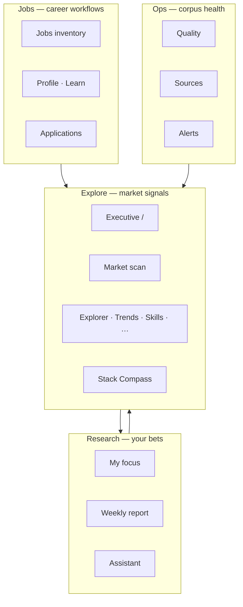
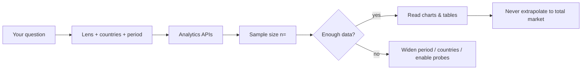

# Atlas / FMI — start here

**Who should read this:** Anyone new to **Freelance Market Intelligence (FMI · Demand Compass)**—freelancers, researchers, and operators who need a shared vocabulary before diving into dashboards or admin tools.

**What you will learn:** How the app is organized into four navigation zones, which controls appear everywhere (locale, lens, countries, view mode), what “observed” counts mean, and where to go next for step-by-step page guides.

FMI is an **evidence-first** web app: authorized job data is collected, normalized, and classified so you explore **observed demand in this database**—not invented “total market size.” The primary nav groups routes into four zones; `frontend/lib/navZones.ts` is the source of truth for labels and paths.

Prefer a **screen recording** first: [VISUAL-TOUR.md](VISUAL-TOUR.md) (full platform ~9.5 min with end-of-page scrolls, plus one video per zone).

---

## Zone map

| Zone | Purpose | Manual |
|------|---------|--------|
| **Explore** | Market dashboards, trends, skills, rates, geo, stack | [EXPLORE.md](./EXPLORE.md) |
| **Jobs** | Job inventory, local profile, study plan, applications | [CAREER.md](./CAREER.md) |
| **Research** | Focus intents, LLM briefs, weekly report | [RESEARCH.md](./RESEARCH.md) |
| **Ops** | Corpus health, connectors, alerts | [ADMIN.md](./ADMIN.md) |

Routes are locale-prefixed: `/en/...` or `/it/...`.

---

## Executive home (Atlas landing)

The default route `/` is the **Executive** dashboard—a chart-forward landing with top KPIs, rising/cooling signals, and widgets you can tailor via dashboard preferences.

### What you'll see

- **Lens** toggle: `market` | `focus` | `compare` (see below).
- **Country filter** in the chrome on analytics paths (including Executive).
- **Period** chip where time-windowed metrics apply (default 30 days from prefs).
- Widgets driven by prefs (`visible_widgets`, nav visibility, presets).
- In **guided** view mode: coverage notes, sample sizes (`n=`), and methodology hints.

### How to use

1. Pick **lens** and **countries** to match your question (whole radar vs your personal focus bets).
2. In **guided** mode, read coverage copy before interpreting growth percentages.
3. Follow widget links into Trends, Skills, Relations, or Research when a signal needs a deep dive.

### Common pitfalls

- Treating headline counts as “market size”—they are **observed jobs in this DB** (ADR-001).
- Forgetting that **thin** evidence rows may appear in job lists but are often excluded from skill/rate KPI denominators.
- Setting countries on Executive then wondering why **Jobs** or **Explorer** did not change—those pages use **in-page** country filters instead.

Full Explore walkthrough: [EXPLORE.md](./EXPLORE.md).

---

## Shared controls

### Locale (EN / IT)

- UI strings follow **English** or **Italian** via Next.js `[locale]` routing.
- Default preference is stored in dashboard prefs (`locale: "en" | "it"`) in `localStorage` key `fmi:dashboardPrefs:v2`.
- Analytics APIs are locale-agnostic; only labels and copy change.

### Analytics lens: market | focus | compare

Lenses slice the job corpus by **research intent** provenance (ADR-007):

| Lens | Corpus |
|------|--------|
| **market** | Jobs matched to **discovery** probes (transparent market-scan watchlist). |
| **focus** | Jobs matched to your **focus** research intents (personal bets). |
| **compare** | Side-by-side market vs focus counts and charts where supported. |

The lens toggle appears on most analytics pages. URL `?lens=` overrides sticky prefs when present. Optional `query_ids` narrows focus to specific intent rows.

Scheduled ingestion refreshes discovery and focus corpora daily; dashboards read the DB—manual **Sync** on Market scan or My focus is an exception path ([RESEARCH.md](./RESEARCH.md), [ADMIN.md](./ADMIN.md)).

### Country filter

On analytics routes listed in `ANALYTICS_COUNTRY_PATHS`, the chrome **country filter** restricts KPIs to selected ISO codes. Selections persist in prefs (`focus_countries`) and sync to `?countries=` on those paths.

**Chrome country filter applies on:** `/`, `/market-scan`, `/trends`, `/skills`, `/relations`, `/rates`, `/countries`, `/languages`, `/certifications`, `/quality`, `/assistant`, `/focus`.

**Exceptions:** **Jobs**, **Explorer**, and **Sources** use **in-page** country filters so they do not fight global prefs.

### View mode: guided vs trends_only

Per ADR-004, `view_mode` controls presentation density:

- **guided** (default) — definitions, evidence copy, methodology hints, recommendations, coverage notes.
- **trends_only** — charts and tables with minimal coaching; no recommendation panels.

Both modes use the same evidence-first APIs (ADR-001); the mode does not change backend math.

### Period

`period_days` (default 30) in dashboard prefs scopes time-windowed analytics on pages that show a period chip.

---

## Evidence-first mindset

### Observed ≠ market size

Every count is **observed records in this database** with sample size and limits—not extrapolated market totals. Growth may read `insufficient_data`. Guided mode surfaces disclaimers; trends_only shortens copy but must not imply full-market coverage.

**Evidence tiers:**

| Tier | Meaning | In default KPIs |
|------|---------|-----------------|
| **standard** | Usable posting body | Included in skills, rates, trends, LLM briefs |
| **thin** | Capped/snapshot/synthetic snippets | Visible in jobs/quality; excluded unless client opts down |

Quality **by source** shows `% thin` per connector ([ADMIN.md](./ADMIN.md)).

---

## Authentication and access

| Mechanism | Who | Use |
|-----------|-----|-----|
| **OIDC (Keycloak)** | Browser users | Optional when `OIDC_ENABLED=true`. Realm roles **`admin`** and **`user`**. Frontend sends `Authorization: Bearer` on API calls. |
| **API_KEY** (`X-API-Key`) | Machines | Cron, smoke tests, scheduler—**not** the browser. |
| **OPS_API_TOKEN** (`X-Ops-Token`) | Break-glass | Credential PUT/DELETE and some ops when OIDC is off or as documented fallback; admin JWT is preferred when OIDC is on. |

End-user **profile skills and certs** live in **browser localStorage** (`fmi:userProfile:v1`) per ADR-009—not a per-user server profile in v1. Skill-gap and adjacent briefs accept owned skills in the POST body so analysis works without a DB profile row.

**Applications and alerts** use a single server profile row today; they are **not** tied to OIDC identity—no cross-device or multi-user sync (ADR-009). Details: [CAREER.md](./CAREER.md).

---

## Demand Compass (product thread)

ADR-007 defines a **dual corpus**: **discovery** (market radar) + **focus** (your intents) + dump/feed boards. The UI exposes discovery on **Market scan**, focus on **My focus**, and lenses across dashboards. LLM features are an **evidence coach**—they wrap analytics; they do not invent totals.

Typical loop:

1. Keep **discovery** probes enabled ([EXPLORE.md](./EXPLORE.md) — Market scan).
2. Maintain **focus** intents ([RESEARCH.md](./RESEARCH.md)).
3. Read **Explore** dashboards with the right lens.
4. Use **Assistant** or **Stack Compass** for narratives and proposed watches—accept watches explicitly.
5. Operators verify ingestion on **Quality** and **Sources** ([ADMIN.md](./ADMIN.md)).

---

## Where to go next

| Goal | Manual |
|------|--------|
| Market signals, trends, stack | [EXPLORE.md](./EXPLORE.md) |
| Focus intents, assistant, report | [RESEARCH.md](./RESEARCH.md) |
| Profile, learn, jobs, applications | [CAREER.md](./CAREER.md) |
| Quality, sources, alerts | [ADMIN.md](./ADMIN.md) |
| Production procedures, scheduler, incidents | [../ops/RUNBOOKS.md](../ops/RUNBOOKS.md) |
| Local dev stack | [../ops/LOCAL.md](../ops/LOCAL.md) |

---

## Key ADRs (brief)

- **[ADR-001](../decisions/ADR-001-evidence-first-kpis.md)** — Observed counts only; methodology metadata; thin tier handling.
- **[ADR-004](../decisions/ADR-004-dashboard-modes.md)** — Guided vs trends_only; prefs in localStorage.
- **[ADR-007](../decisions/ADR-007-query-first-sync.md)** — Discovery + focus corpora; lenses; no silent env topic defaults.
- **[ADR-009](../decisions/ADR-009-keycloak-identity-localstorage-profile.md)** — OIDC roles; localStorage profile; admin-only secrets.

Glossary: [../GLOSSARY.md](../GLOSSARY.md).
