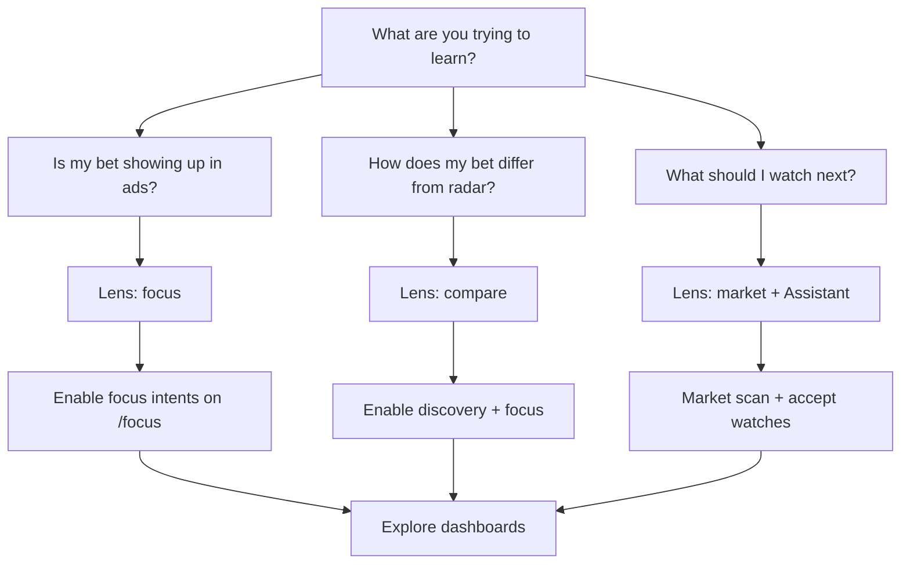

# Research zone — Demand Compass workflows

**Who should read this:** Freelancers and power users who define **what they are betting on** (focus intents), use the **Assistant** as an evidence-backed coach, and review the **weekly report**—without treating LLM copy as market truth.

**What you will learn:** How discovery vs focus corpora differ, how to manage intents, how proposed watches become real probes, and how lenses tie Research to Explore dashboards.

The **Research** zone supports the **Demand Compass** workflow (ADR-007): **discovery** stays independent via Market scan; **focus** holds your typed topics; LLM briefs and reports summarize **observed** KPIs—they never invent totals.

Routes (locale-prefixed) from [navZones.ts](../../frontend/lib/navZones.ts):

| Path | Nav label |
|------|-----------|
| `/focus` | My focus |
| `/report` | Weekly report |
| `/assistant` | Assistant |

---

## Decision flow: market vs focus vs compare



---

## My focus (`/focus`)

**Purpose:** Create and operate **focus** research intents (`SearchQuery.kind = focus`)—your topics, synced on a budgeted schedule alongside discovery and dump/feed collectors.


### What you'll see

- Cards for each focus intent: query text, countries, enabled flag, sync actions.
- **Country suggestions** from intents—the UI may suggest ISO codes for the country filter but **never auto-applies** them.
- Not-ready state with retry if the API is unavailable (migrations, empty DB).

### How to use

1. **Create** an intent with query text, optional countries, and enabled flag. User-origin intents are marked accordingly.
2. **Enable/disable** cards to include or exclude a topic from focus-lens analytics and sync fan-out.
3. **Sync** a single intent when you need a manual collection run (daily scheduler remains primary).
4. Review country suggestions; apply countries in the chrome filter when **you** choose to narrow dashboards.
5. Switch dashboard lens to **focus** or **compare** on Explore pages to see corpus impact.

### Common pitfalls

- Disabling all focus intents then using **focus** lens everywhere—expect empty or thin analytics.
- Expecting country suggestions to change filters automatically—they are hints only.
- Forgetting that **discovery** probes live on **Market scan**, not here ([EXPLORE.md](./EXPLORE.md)).

**Relation to Market scan:** Discovery intents feed the **market** lens; focus intents feed **focus**. Disabling all discovery probes thins market analytics—watch warnings on both pages.

---

## Assistant (`/assistant`)

**Purpose:** Demand Compass LLM surfaces—structured briefs over existing analytics plus **proposed watches** you must explicitly accept.


### What you'll see

- **Demand Compass briefs** — narratives tied to API payloads (sample sizes, limits). Types include market context, focus vs market, rising/cooling technology stories, and adjacent skill stories where implemented.
- **Propose watches** — candidate discovery or focus intents **not** auto-created.
- Lens, period, and country context from dashboard prefs and URL params where wired.
- Errors from misconfigured LLM in brief sections—not fabricated KPIs.

### How to use

1. Set lens, period, and countries to match the question before reading briefs.
2. In **guided** mode, read disclaimers and `lens_sample_size`.
3. For **proposed watches**, click **Accept** only when you want a new intent; acceptance calls `acceptResearchWatch` (name, query text, kind).
4. After accepting, verify intent lists on **Market scan** and **My focus**.
5. Declining is implicit (ignore)—there is no silent enrollment.

### Common pitfalls

- Treating brief prose as independent research—it wraps the same observed analytics as Explore.
- Accepting watches without checking for duplicate query text on focus/discovery lists.
- Assuming Assistant fixes thin **market** lens data—enable discovery probes and check [ADMIN.md](./ADMIN.md) Quality first.

**Operator note:** LLM provider health and classification mode appear on Sources and Quality; see [../ops/RUNBOOKS.md](../ops/RUNBOOKS.md) for LLM/scheduler issues.

---

## Weekly report (`/report`)

**Purpose:** Render the latest **weekly report** from `GET /api/v1/reports/weekly`—markdown summary of observed KPI snippets, gaps, and compass context for the period.

### What you'll see

- Markdown-rendered report body in the UI.
- Embedded **LLM health** metadata when present (degraded narrative sections).
- Empty or stale state if generation has not run yet.

### How to use

1. Open the page after scheduled report generation (scheduler/cron in production).
2. Read LLM health metadata when present to know if narrative sections are degraded.
3. Use alongside Executive and Profile skill gaps for a guided weekly review.

### Common pitfalls

- Expecting a fresh report on demand in every environment—generation is scheduler-driven ([../ops/RUNBOOKS.md](../ops/RUNBOOKS.md)).
- Skipping Explore when the report flags thin coverage—fix probes and connectors, not just re-read the report.

Reports are JSON-backed with markdown rendering; they summarize **observed** data aligned with ADR-001.

---

## Accept watches (end-to-end)

```text
Assistant or Stack Compass → proposed candidate list
        → user clicks Accept
        → POST accept research watch
        → new SearchQuery (discovery or focus)
        → future sync matches jobs (job_intent_matches)
        → lens analytics include matched jobs
```

Always verify intent lists on **Market scan** and **My focus** after accepting. Stack flow: [EXPLORE.md](./EXPLORE.md) — Stack Compass.

---

## Lens and filters in Research workflows

| Goal | Lens | Also check |
|------|------|------------|
| “Is my bet showing up?” | focus | Focus intents enabled; sync status |
| “How does my bet differ from radar?” | compare | Discovery probes enabled; sufficient market n |
| “What should I watch next?” | market (+ Assistant) | Accept watches → discovery or focus |

Country filter applies on `/focus` and `/assistant` per analytics path rules ([OVERVIEW.md](./OVERVIEW.md)).

---

## Auth

- Read paths work with anonymous/local dev depending on deployment.
- Production OIDC: Bearer token on API calls; role **user** is enough for focus and assistant read/write on intents.
- Admin-only connector and credential actions stay on **Sources** ([ADMIN.md](./ADMIN.md)).

---

## Sync and scheduling (what users should expect)

| Action | Who triggers | Effect |
|--------|--------------|--------|
| Daily crawler tick | Scheduler / cron ([../ops/RUNBOOKS.md](../ops/RUNBOOKS.md) §3) | Refreshes discovery, focus, dump/feed within budget |
| **Sync** on one intent card | You | One-off collection for that probe |
| Accept watch | You | Creates intent; matched jobs appear after next successful sync |
| Disable intent | You | Stops fan-out; lens corpora shrink on next read |

If Market scan warns about disabled discovery probes, fix probes before blaming Assistant briefs for thin **market** narrative.

---

## Troubleshooting (user-facing)

| Symptom | Likely cause | What to do |
|---------|--------------|------------|
| Focus page “not ready” | API/migrations/empty DB | Retry; operator: RUNBOOKS §1–§2 |
| Brief sections error text | LLM misconfigured | Operator: Sources summary + Quality LLM buttons |
| Compare mode one-sided empty | Focus or market corpus thin | Enable intents; check Quality by source |
| Accepted watch not collecting | Sync not run yet / connector issue | Manual Sync; operator: Sources run |

---

## Related docs

- [OVERVIEW.md](./OVERVIEW.md) — lenses, evidence-first rules, prefs
- [EXPLORE.md](./EXPLORE.md) — dashboards fed by intent matches
- [CAREER.md](./CAREER.md) — Learn proposed watches, Profile skills
- [../decisions/ADR-007-query-first-sync.md](../decisions/ADR-007-query-first-sync.md) — discovery vs focus design
- [../ops/RUNBOOKS.md](../ops/RUNBOOKS.md) — Demand Compass smoke, scheduler (§3)
