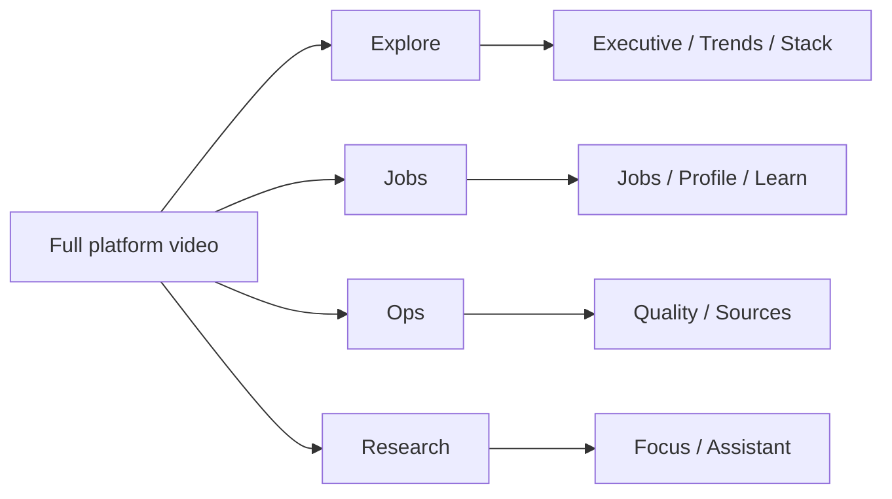

# Visual tour (video + screenshots)

**Who should read this:** Anyone who wants to *see* how FMI works before reading the manuals.

**What you will learn:** A recommended path through Atlas. Prefer the **videos** (human pace, on-screen captions). Still frames below remain for Markdown preview and print.

Start the app with [ops/LOCAL.md](../ops/LOCAL.md), then open `http://localhost:3000/en` to click along live.

## Product videos (start here)

| Video | Duration | Covers |
|-------|----------|--------|
| [Full platform](../assets/videos/00-full-platform.mp4) | ~10+ min | Every Atlas zone; each page scrolled top→bottom |
| [Explore](../assets/videos/01-explore.mp4) | ~5 min | Executive → Stack; full-page scroll on every screen |
| [Jobs & career](../assets/videos/02-jobs-career.mp4) | ~2.5 min | Job Explorer, profile + gaps, Study Advisor, applications |
| [Ops](../assets/videos/03-ops.mp4) | ~3 min | Data quality, sources catalog, alerts (no credentialed runs) |
| [Research](../assets/videos/04-research.mp4) | ~1.5 min | Focus intents, report, assistant |

<video controls width="100%" src="../assets/videos/00-full-platform.mp4">
  <a href="../assets/videos/00-full-platform.mp4">Download full platform tour (MP4)</a>
</video>

Index and re-record notes: [../assets/videos/README.md](../assets/videos/README.md).

---

## Still frames (optional)

Same order as a short product scrub—use when you cannot play video.

### 1. Executive — “What is moving?”

Landing desk: rising/cooling, geo, mixes. Always read **n=** and coverage notes in Guided mode.

→ Details: [EXPLORE.md](EXPLORE.md#executive--)

### 2. Market scan — discovery probes

Enable broad discovery topics that feed the **Market** lens. These are not your personal focus bets.

### 3. Trends — skills rising vs cooling

Half-period growth on observed skill mentions. Status `insufficient_data` means do not trust the %.

### 4. Stack Compass — what to learn next

Compares your local profile skills to market co-occurrence / gaps.

### 5. Certifications — market cert signals

Observed cert mentions (taxonomy-backed), including by-country views.

### 6. My focus — personal research intents

Create **focus** intents; Sync pulls matching jobs into the Focus lens.

→ [RESEARCH.md](RESEARCH.md)

### 7. Assistant — evidence briefs

Ask for rising/cooling, geo, adjacent skills, or suggest watches—**Accept** before a watch is persisted.

### 8. Profile — skills you claim

Stored in **browser localStorage** (not multi-device sync). Feeds Stack and Learn.

→ [CAREER.md](CAREER.md)

### 9. Learn — Study Advisor

Turns Stack evidence into a structured study plan (optional LLM refine when configured).

### 10. Jobs — inventory

Canonical job list with filters; still observed DB rows, not “all jobs on the internet.”

### 11. Sources — operators

Run ACTIVE connectors, browse catalog, manage credentials / LLM (admin).

→ [ADMIN.md](ADMIN.md) · deep ops [../ops/RUNBOOKS.md](../ops/RUNBOOKS.md)

### 12. Quality — corpus health

Read-only view of missingness / source health before you trust a KPI.

---

## Next

- Shared concepts (lens, evidence, auth): [OVERVIEW.md](OVERVIEW.md)
- Architecture diagrams: [../architecture/OVERVIEW.md](../architecture/OVERVIEW.md)
- Asset index: [../assets/README.md](../assets/README.md)
