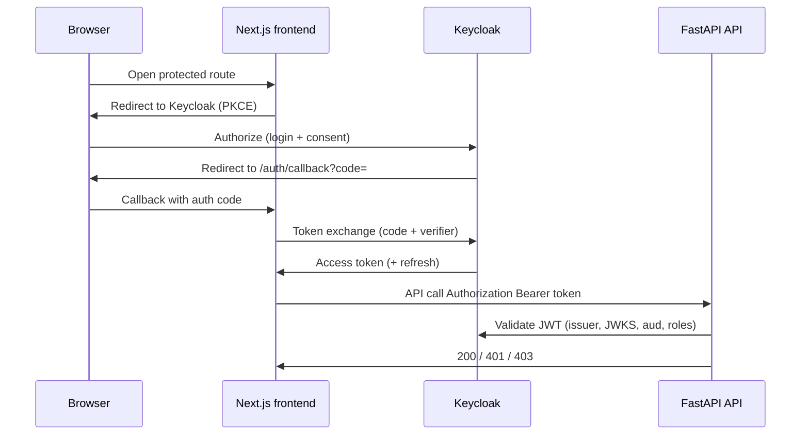

# Keycloak (OIDC) for FMI

This guide explains **why** FMI uses external Keycloak, how browser login reaches the API, and what operators must configure in realm, clients, and Helm values.

**Related docs:** [ADR-009](../decisions/ADR-009-keycloak-identity-localstorage-profile.md) (identity model), [ADR-010](../decisions/ADR-010-admin-llm-runtime-config.md) (admin LLM ops), [HELM-k3s.md](HELM-k3s.md), [RELEASE.md](RELEASE.md#environment-matrix), [LOCAL.md](LOCAL.md), [RUNBOOKS.md §4–§6](RUNBOOKS.md). End-user context: [manuals/OVERVIEW.md](../manuals/OVERVIEW.md).

**Not covered here:** Installing Keycloak itself (use your org’s IdP runbook). Local dev without OIDC stays keyless — see [LOCAL.md](LOCAL.md).

---

## Why OIDC is separate from the chart

FMI does **not** ship Keycloak in the Helm chart. Production identity lives in a dedicated IdP so you can reuse corporate SSO, rotate keys centrally, and keep machine auth (`X-API-Key`) separate from human sessions (Bearer JWT).

Two auth planes coexist:

| Plane | Mechanism | Typical caller |
|-------|-----------|----------------|
| Human | Bearer access token (PKCE from SPA) | Browser → API |
| Machine | `X-API-Key: $API_KEY` | CronJob, `scheduler_tick.sh`, `smoke_e2e.sh` |
| Break-glass | `X-Ops-Token: $OPS_API_TOKEN` | Ops when OIDC is on (Bearer is **not** ops token) |

---

## Login sequence (browser → Keycloak → callback → API)

Understanding this flow helps debug 401 loops, wrong `aud`, and CORS that only appears after login.



**Operator checkpoints:**

1. Redirect URIs in Keycloak match **exact** frontend URLs (including `127.0.0.1` vs `localhost` if both are used).
2. Access token `aud` matches `OIDC_AUDIENCE` on the API (or audience check disabled only in dev).
3. Realm or client roles include `user` / `admin` as expected by [API deps](../../backend/app/api/deps.py).
4. `API_CORS_ORIGINS` lists the frontend origin the browser actually uses.

Wrong auth symptoms: [RUNBOOKS.md §4–§6](RUNBOOKS.md).

---

## Realm roles

| Realm role | Purpose |
|------------|---------|
| `user` | Dashboard, market reads, localStorage-backed profile |
| `admin` | Everything `user` can do + connector credentials mutate, ops credential fields, LLM admin |

Map realm roles into the access token (realm roles claim and/or `resource_access.<client>.roles`). The backend accepts `admin` / `user` from realm roles or client roles for `OIDC_CLIENT_ID`.

---

## Keycloak clients (operator checklist)

### 1. Public SPA (`fmi-frontend`)

- Client type: **public**, PKCE **S256**
- Valid redirect URIs:
  - `https://<frontend>/auth/callback`
  - Local dev if used: `http://localhost:3000/auth/callback`, `http://127.0.0.1:3000/auth/callback`
- Web origins: frontend origin(s) only

### 2. API audience

Access token `aud` must match `OIDC_AUDIENCE` on the API (often the client id or a dedicated resource client). Set `OIDC_AUDIENCE` to whatever Keycloak puts in `aud`.

**Decision:** If tokens lack a stable audience in dev, you may leave `OIDC_AUDIENCE` empty to skip `aud` check — **never** do that in production.

---

## API environment

```bash
OIDC_ENABLED=true
OIDC_ISSUER=https://keycloak.example/realms/fmi
OIDC_AUDIENCE=fmi-api   # or empty to skip aud check (dev only)
OIDC_CLIENT_ID=fmi-frontend
# OIDC_JWKS_URL=         # optional; default {issuer}/protocol/openid-connect/certs
OIDC_REQUIRE_USER=true   # browser routes need Bearer user|admin
```

Machine callers keep `X-API-Key: $API_KEY` and bypass JWT.

Credential PUT/DELETE require JWT role `admin`. Break-glass: `X-Ops-Token: $OPS_API_TOKEN` when OIDC is on.

---

## Frontend environment

```bash
NEXT_PUBLIC_OIDC_ENABLED=true
NEXT_PUBLIC_KEYCLOAK_URL=https://keycloak.example
NEXT_PUBLIC_KEYCLOAK_REALM=fmi
NEXT_PUBLIC_OIDC_CLIENT_ID=fmi-frontend
```

For production images, bake `NEXT_PUBLIC_*` via `frontend/Dockerfile.prod` build-args. Helm can set runtime env on the frontend Deployment, but prefer **bake** for API URL and OIDC flags used at build time.

Align `NEXT_PUBLIC_API_URL` with the browser-visible API host (Ingress), not in-cluster service DNS.

---

## Helm values (external Keycloak)

External Keycloak is the default (no in-chart IdP):

```yaml
oidc:
  enabled: true
  issuer: "https://keycloak.example/realms/fmi"
  audience: "fmi-api"
  clientId: "fmi-frontend"
  requireUser: true

frontend:
  oidc:
    enabled: true
    keycloakUrl: "https://keycloak.example"
    realm: "fmi"
    clientId: "fmi-frontend"
```

Rendered into API ConfigMap: `OIDC_*`. Frontend Deployment: `NEXT_PUBLIC_OIDC_*` (see chart templates).

Secrets unchanged: `API_KEY`, `OPS_API_TOKEN` for machines and break-glass. Full matrix: [RELEASE.md#environment-matrix](RELEASE.md#environment-matrix).

---

## Smoke matrix (who gets what HTTP status)

| Actor | Expect |
|-------|--------|
| Anonymous (`OIDC_REQUIRE_USER=true`) | 401 on market/dashboard without Bearer |
| JWT `user` | 200 on dashboard; 403 on PUT credentials |
| JWT `admin` | 200 on PUT credentials (with body); LLM ops settings mutate |
| `X-API-Key` | 200 on `POST /api/v1/scheduler/run` (or `scheduler_tick.sh`) |
| `X-Ops-Token` (OIDC on) | Break-glass ops paths per API deps |

Scripted check when Keycloak is up:

```bash
# configure env to match your staging realm, then:
./backend/scripts/smoke_oidc_roles.sh
```

Local Compose leaves `OIDC_ENABLED=false` so default smoke stays keyless — [LOCAL.md](LOCAL.md).

---

## CORS + OIDC together

OIDC does not replace CORS. The browser still sends `Origin` on API calls **after** login.

Set `API_CORS_ORIGINS` to exact frontend origins (scheme + host + port). Include every hostname users type in the browser. Recreate or roll the API after changes (Compose: `docker compose up -d --force-recreate api`; Helm: upgrade release).

---

## Operator decision tree (auth misbehaviour)

```text
401 on all API calls after login?
├─ Token missing in browser → check FE OIDC flags / callback URL in Keycloak
├─ Token present → check OIDC_ISSUER, clock skew, JWKS reachability from API pod
└─ 401 only on some routes → check OIDC_REQUIRE_USER and route deps

403 on credentials or LLM ops?
├─ JWT has user but not admin → assign admin role in Keycloak
└─ Expect break-glass → X-Ops-Token (not Bearer) per KEYCLOAK smoke matrix

Scheduler works in curl but not CronJob?
└─ CronJob must send X-API-Key; JWT is not used for machine paths
```

Admin UI behaviour: [manuals/ADMIN.md](../manuals/ADMIN.md).
