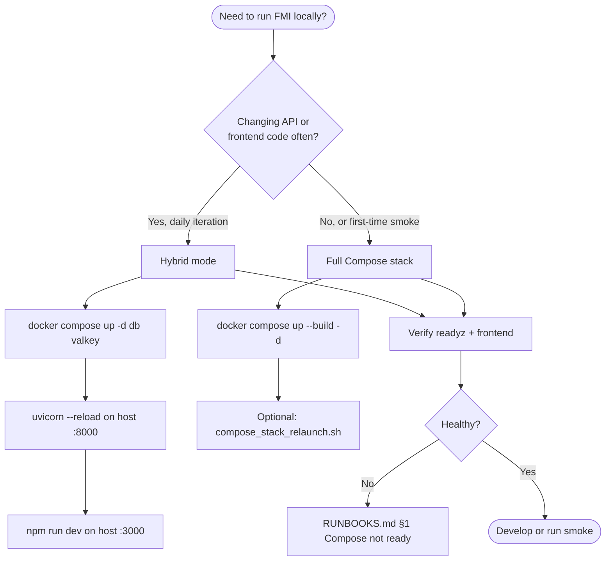

# Local development (FMI)

This guide helps **human operators** run FMI on a laptop or workstation: choose a dev mode, wire URLs correctly, and verify the stack before you change code or demo to others.

**Related docs:** [HELM-k3s.md](HELM-k3s.md) (production-shaped deploy), [KEYCLOAK.md](KEYCLOAK.md) (OIDC), [RELEASE.md](RELEASE.md) (CI and tagging), [RUNBOOKS.md](RUNBOOKS.md) (symptom-first fixes). Architecture context: [architecture/OVERVIEW.md](../architecture/OVERVIEW.md), [architecture/DATABASE.md](../architecture/DATABASE.md). Product walkthroughs: [manuals/OVERVIEW.md](../manuals/OVERVIEW.md), [manuals/ADMIN.md](../manuals/ADMIN.md).

**Not covered here:** Kubernetes install, Keycloak realm setup, or production rollback — use the sibling ops docs above.

---

## Why two local modes exist

FMI needs Postgres, Valkey, a FastAPI API, and a Next.js frontend. You can either run **everything in Docker** (closest to “it just works” for newcomers) or run **only data services in Docker** and keep API/frontend on the host (fastest edit–reload loop for daily development).



**Choose hybrid when:** you edit Python or TypeScript frequently and want native hot reload without rebuilding images.

**Choose full Compose when:** you want one command, parity with CI smoke paths, or you do not maintain a local Python venv.

---

## First-time setup

Copy environment defaults and install backend dependencies once. Schema must exist before the API can serve meaningful routes.

```bash
cp .env.example .env
# Edit secrets if needed; defaults are fine for local dev
```

Apply migrations (required for hybrid; full Compose also runs this on API start, but running locally catches errors early):

```bash
cd backend && source .venv/bin/activate
pip install -r requirements.txt
alembic upgrade head
```

**Why migrations first:** the API assumes tables for jobs, sources, intents, and ops settings exist. Skipping `alembic upgrade head` produces boot failures or empty 500s that look like “the app is broken” when the database is simply unmigrated.

---

## Hybrid mode (recommended for backend/frontend iteration)

**Why:** Docker only runs stateful services; your editor runs the app processes with `--reload` and `next dev`.

Start data tier:

```bash
docker compose up -d db valkey
```

API (host):

```bash
cd backend && source .venv/bin/activate
uvicorn app.main:app --host 0.0.0.0 --port 8000 --reload
```

Frontend (host):

```bash
cd frontend && npm ci && npm run dev
```

**Environment defaults** (from `.env.example`):

| Setting | Hybrid value | Why |
|---------|--------------|-----|
| `DATABASE_URL` | host `localhost:5432` | API on host talks to published Postgres port |
| `REDIS_URL` | `redis://localhost:6380/0` | Compose maps Valkey **6380→6379** on the host |
| `NEXT_PUBLIC_API_URL` | `http://localhost:8000` | Browser calls the host API |
| `INTERNAL_API_URL` | omit for `next dev` | Falls back to `NEXT_PUBLIC_API_URL` |

---

## Full Compose stack

**Why:** single `docker compose up` brings API, frontend, db, and Valkey with bind mounts; API uses `--reload` and frontend uses `next dev` inside containers.

```bash
docker compose up --build -d
# or verified relaunch (health + optional smoke):
./scripts/compose_stack_relaunch.sh
```

**Inside Compose networking:**

| Setting | In-container value | Why |
|---------|-------------------|-----|
| `DATABASE_URL` | `@db:5432` | Service DNS, not localhost |
| `REDIS_URL` | `redis://valkey:6379/0` | Valkey service name |
| `INTERNAL_API_URL` | `http://api:8000` (default in `docker-compose.yml`) | Next.js SSR from frontend container |
| `NEXT_PUBLIC_API_URL` | **host-reachable** `http://localhost:8000` | Browser runs on your machine, not inside the frontend container |

Never put `http://api:8000` in `NEXT_PUBLIC_*` — the browser cannot resolve Docker service names.

---

## Ports and health probes

| Service   | Host port | Notes        |
|-----------|-----------|--------------|
| API       | 8000      | `API_PORT`   |
| Frontend  | 3000      |              |
| Postgres  | 5432      | `POSTGRES_PORT` |
| Valkey    | 6380      | not 6379 on host |

**Liveness vs readiness:** `GET /livez` means the process is up. `GET /readyz` returns **503** if Postgres or required Valkey is unreachable — use it before declaring “stack is good.”

```bash
curl -sf http://127.0.0.1:8000/readyz
curl -sf -o /dev/null http://127.0.0.1:3000
```

No API key is required for these probes.

---

## CORS and API URL pitfalls

Browsers treat `http://localhost:3000` and `http://127.0.0.1:3000` as **different origins**. With `APP_ENV=development`, include **both** in `API_CORS_ORIGINS` (see `.env.example`).

After changing CORS or API-related env in Compose, recreate the API container so env is picked up:

```bash
docker compose up -d --force-recreate api
```

| Variable | Consumer | Rule |
|----------|----------|------|
| `NEXT_PUBLIC_API_URL` | Browser, client bundles | Host URL (`localhost:8000` or public ingress in prod builds) |
| `INTERNAL_API_URL` | Next.js SSR inside Compose | Docker service `http://api:8000` |

**Typical symptoms:** UI loads but XHR fails (CORS), or SSR errors while direct `curl` to the API works. See [RUNBOOKS.md §4](RUNBOOKS.md#4-ingress--cors--wrong-api-url).

---

## Stack relaunch script

[`scripts/compose_stack_relaunch.sh`](../../scripts/compose_stack_relaunch.sh) rebuilds the **full** stack and verifies health. Use it after compose-facing changes or when smoke fails mysteriously.

```bash
./scripts/compose_stack_relaunch.sh
COMPOSE_STACK_FORCE=1 ./scripts/compose_stack_relaunch.sh   # ignore 30m throttle
COMPASS_SMOKE=0 ./scripts/compose_stack_relaunch.sh         # skip nested Demand Compass in smoke_e2e
COMPOSE_STACK_SKIP_SMOKE=1 ./scripts/compose_stack_relaunch.sh  # readyz + frontend only
```

| Env | Default | Meaning |
|-----|---------|---------|
| `API_URL` | `http://127.0.0.1:8000` | Probe target |
| `FRONTEND_URL` | `http://127.0.0.1:3000` | Probe target |
| `COMPOSE_STACK_WAIT_SEC` | `180` | Wait for health |

Requires repo-root `.env`. Success stamp: `.cursor/compose-stack-last-ok` (gitignored). By default runs `backend/scripts/smoke_e2e.sh` with `COMPASS_SMOKE=1`.

---

## OIDC (Keycloak) locally

**Why defaults are off:** local smoke and Sources workflows assume no Bearer token. Compose sets `OIDC_ENABLED=false`, `OIDC_REQUIRE_USER=false`, and frontend OIDC off.

Production or staging identity setup: [KEYCLOAK.md](KEYCLOAK.md). Decision context: [ADR-009](../decisions/ADR-009-keycloak-identity-localstorage-profile.md).

---

## Bootstrap data (empty dashboards are normal)

The database starts empty. Market and Compass views stay honest until ingest runs.

1. **Sources UI** — open `/en/sources` and run public collectors (Remotive, Arbeitnow, Remote OK, etc.; Greenhouse/Lever when boards are configured in `.env`).
2. **Sample CSV** — quick import without external APIs:

```bash
curl -F "file=@data/samples/jobs_sample.csv" http://localhost:8000/api/v1/imports
```

Discovery watchlist seeds from `data/research/discovery_watchlist.json` on migration/seed paths. Research flows: [manuals/RESEARCH.md](../manuals/RESEARCH.md).

---

## Scheduler (local)

**Why `ENABLE_SCHEDULER=false` by default:** multiple API replicas plus in-process scheduling would duplicate crawler ticks. For a **single** local API replica you may enable it:

Set in `.env`: `ENABLE_SCHEDULER=true`, `SCHEDULER_INTERVAL_SECONDS=86400`, then recreate `api`.

Manual one-shot tick (matches production CronJob contract):

```bash
API_URL=http://127.0.0.1:8000 ./backend/scripts/scheduler_tick.sh
# optional: API_KEY=… if set in .env
```

Check freshness: `GET /api/v1/ops/metrics` → `crawler.last_tick`. Stale tick troubleshooting: [RUNBOOKS.md §3](RUNBOOKS.md#3-scheduler--crawler-stale).

---

## API container user (non-root)

Production images run as `appuser` (uid 1000). Compose sets `user: "${API_UID:-1000}:${API_GID:-1000}"` so bind-mounted `./backend` stays writable without root in the container.

On Linux permission errors on the mount:

```bash
# add to .env:
# API_UID=$(id -u)
# API_GID=$(id -g)
docker compose exec -T api id   # verify uid/gid
```

---

## Quick verification (definition of done locally)

Run these before opening a PR or tagging a release candidate:

```bash
curl -sf http://127.0.0.1:8000/readyz
curl -sf -o /dev/null http://127.0.0.1:3000
cd backend && pytest -q
API_URL=http://127.0.0.1:8000 ./backend/scripts/smoke_e2e.sh
```

Deeper incidents: [RUNBOOKS.md](RUNBOOKS.md). Admin and ops UI: [manuals/ADMIN.md](../manuals/ADMIN.md).

Local LLM (Apple Silicon / Ollama — not vLLM on Mac): [LLM-LOCAL.md](LLM-LOCAL.md).
