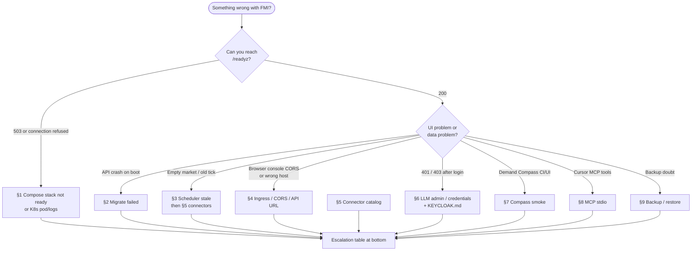

# FMI operator runbooks (symptom-first)

Use this document **under time pressure**: match what you see, run the checks, apply the fix. Setup sequences live in sibling ops docs; this file is diagnostic and remedial.

**Related docs:** [LOCAL.md](LOCAL.md), [HELM-k3s.md](HELM-k3s.md), [KEYCLOAK.md](KEYCLOAK.md), [RELEASE.md](RELEASE.md), [architecture/OVERVIEW.md](../architecture/OVERVIEW.md), [manuals/ADMIN.md](../manuals/ADMIN.md), [manuals/RESEARCH.md](../manuals/RESEARCH.md).

**Legend:** commands marked with no tag are safe to run read-only or locally. Steps that write to production databases or delete PVCs are called out inline.

---

## Triage: where to start



Cheapest checks first: `curl -sf http://127.0.0.1:8000/readyz` (local) or Ingress `/readyz` (deployed).

---

## 1. Compose stack not ready

**Symptoms:** `compose_stack_relaunch.sh` fails; `curl /readyz` 503; frontend unreachable; API container restarting.

**Checks:**

```bash
docker compose ps
docker compose logs api --tail 80
docker compose logs db valkey --tail 40
curl -v http://127.0.0.1:8000/readyz
```

**Common fixes:**

| Cause | Action |
|-------|--------|
| Missing `.env` | `cp .env.example .env` |
| DB not healthy | Wait for `db` healthcheck; `docker compose up -d db` |
| Valkey down with `RATE_LIMIT_BACKEND=redis` | Start `valkey` or set `RATE_LIMIT_BACKEND=memory` locally |
| Migration failure on start | `docker compose logs api`; fix DB; `cd backend && alembic upgrade head` |
| Port conflict | Change `API_PORT` / stop other services on 8000/3000 |
| Stale throttle on relaunch | `COMPOSE_STACK_FORCE=1 ./scripts/compose_stack_relaunch.sh` |

**Verify:** `./scripts/compose_stack_relaunch.sh` or `COMPOSE_STACK_SKIP_SMOKE=1` for health-only.

Setup detail: [LOCAL.md](LOCAL.md).

---

## 2. Migrate failed

**Symptoms:** API exits on boot; Helm initContainer/migrate Job failed; `alembic` errors in logs.

**Checks:**

```bash
cd backend && alembic current
alembic history --verbose | tail
# Compose:
docker compose exec -T api alembic current
```

**Actions:**

- Ensure `DATABASE_URL` matches running Postgres (credentials, host, DB name).
- Apply forward: `alembic upgrade head` (Compose API command does this on start).
- K8s: `kubectl -n fmi logs job/<migrate-job-name>`; fix DB connectivity; re-run upgrade.
- **Do not** `alembic downgrade` in prod without a written plan — prefer forward fix revision.

Release context: [RELEASE.md#alembic-policy](RELEASE.md#alembic-policy), [architecture/DATABASE.md](../architecture/DATABASE.md).

---

## 3. Scheduler / crawler stale

**Symptoms:** Empty Market/Compass; old `crawler.last_tick` in `GET /api/v1/ops/metrics`; no new jobs.

**Checks:**

```bash
curl -s http://127.0.0.1:8000/api/v1/ops/metrics | jq .crawler
```

**Actions:**

| Environment | Tick |
|-------------|------|
| Local Compose | `ENABLE_SCHEDULER=true` + recreate `api`, or `API_URL=… ./backend/scripts/scheduler_tick.sh` |
| Prod / Helm | CronJob enabled; `ENABLE_SCHEDULER=false` on API; manual: `kubectl create job --from=cronjob/fmi-api-scheduler …` |
| Force same UTC day | `curl -X POST -H "X-API-Key: $API_KEY" "$API_URL/api/v1/scheduler/run?force=true"` |

Ensure discovery intents enabled (`/en/market-scan`) and connectors **ACTIVE** with registry + catalog alignment (§5).

---

## 4. Ingress / CORS / wrong API URL

**Symptoms:** Browser console CORS errors; UI calls wrong host; SSR 500 but direct API OK; mixed `localhost` vs `127.0.0.1`.

**Fixes:**

- Set `API_CORS_ORIGINS` to **exact** frontend origins (comma-separated). Include both `http://localhost:3000` and `http://127.0.0.1:3000` locally.
- `NEXT_PUBLIC_API_URL` = URL the **browser** uses (Compose: `http://localhost:8000`; prod: `https://api.<domain>`).
- Compose SSR: `INTERNAL_API_URL=http://api:8000` — never put `http://api:8000` in `NEXT_PUBLIC_*`.
- Prod: rebuild frontend after changing public API URL or OIDC flags.
- Helm: align `ingress.hosts`, `frontend.publicApiUrl`, `api.env.API_CORS_ORIGINS`, TLS.

Recreate API after CORS env changes: `docker compose up -d --force-recreate api`.

URL rules: [LOCAL.md#cors-and-api-url-pitfalls](LOCAL.md#cors-and-api-url-pitfalls), [HELM-k3s.md](HELM-k3s.md).

---

## 5. Connector catalog / registry / DB misalignment

**Symptoms:** Source marked ACTIVE but no jobs; collector errors; catalog count ≠ runnable connectors.

Three truths must match:

| Truth | Location |
|-------|----------|
| Catalog SoR | `data/sources/catalog.json` |
| Registry | `backend/app/collectors/registry.py` |
| DB `sources` | Postgres (seed from catalog) |

**Checklist before ACTIVE:**

1. Catalog entry with correct `connector_key` / access mode ([ADR-003](../decisions/ADR-003-authorized-connectors-only.md)).
2. Collector registered under same key.
3. Credentials vs ATS allowlists — do not confuse (`collectors/credentials.py`).
4. Promote only with evidence: `promote_source_active.py`.
5. Regenerate catalog if generator metadata changed.

**Anti-patterns:** Catalog ACTIVE without adapter; env topic defaults as control plane; treating catalog size as market coverage.

Ops API: `GET /api/v1/ops/connectors`.

---

## 6. LLM admin / credentials

**Symptoms:** Classification falls back unexpectedly; ops LLM settings 403; decrypt errors; connector credential PUT fails.

**Reference:** [ADR-010](../decisions/ADR-010-admin-llm-runtime-config.md).

- **Runtime LLM:** DB row in `llm_runtime_config` overrides env when provider ≠ `none`. Admin JWT (or ops token when OIDC off) for PUT.
- **Master key:** `CREDENTIALS_MASTER_KEY` (Fernet) encrypts connector secrets and LLM API keys. Stable across deploys; rotation requires re-entering secrets.
- **Env bootstrap:** No DB row → falls back to `LLM_PROVIDER`, Ollama/vLLM URLs from env.
- **OIDC:** Credential mutate needs `admin` role or `X-Ops-Token` break-glass ([KEYCLOAK.md](KEYCLOAK.md)).

CI/smoke: `LLM_PROVIDER=none` is normal. Admin UI: [manuals/ADMIN.md](../manuals/ADMIN.md).

---

## 7. Demand Compass smoke + UI path

**Automated:**

```bash
API_URL=http://127.0.0.1:8000 ./backend/scripts/smoke_compass.sh
COMPASS_ACCEPT_WATCH=1 API_URL=… ./backend/scripts/smoke_compass.sh
# nested in compose relaunch / smoke_e2e unless COMPASS_SMOKE=0
```

**Manual UI** (see [manuals/RESEARCH.md](../manuals/RESEARCH.md)):

1. **Market** — `/en` or `/en/trends`, lens Market; honest empty if no crawl.
2. **Focus** — `/en/focus` create/enable intent; Sync now; rematch: `docker compose exec -T api python scripts/rematch_focus_intents.py`.
3. **Compare** — lens Compare; assistant “Focus vs market”.
4. **Accept watch** — `/en/assistant` → Suggest watches → Accept (persist only after Accept).

**Pass:** signals or honest empty + discovery enabled; focus matches after sync; compare paired metrics.

---

## 8. MCP stdio (Cursor)

**Symptoms:** `fmi-analytics` missing in Cursor; tools fail; DB errors from MCP.

1. `cp .cursor/mcp.json.example .cursor/mcp.json`
2. Absolute paths to `backend/.venv/bin/python` and `backend/` cwd
3. `DATABASE_URL` (prefer `DATABASE_URL_READONLY` SELECT-only)
4. Restart Cursor → Settings → MCP → **11 tools**
5. Smoke: `cd backend && python -c "from app.mcp.server import build_mcp; build_mcp()"`

Do not commit `.cursor/mcp.json` or production passwords.

**Agent pattern:** metadata → propose → validate → observed counts; never invent rates.

---

## 9. Backup / restore

**Baseline backup:**

```bash
./backend/scripts/backup_db.sh [output.sql]
# prefers docker compose exec db pg_dump when Compose db is up
```

**Verify paths (non-destructive):**

```bash
./backend/scripts/backup_smoke.sh    # schema dump, discarded
./backend/scripts/restore_smoke.sh # schema → temp DB → drop; never touches primary
```

Override clients: `PG_DUMP`, `PSQL`, `POSTGRES_*` env vars.

**Restore to primary (manual, destructive):** use org backup runbook + `psql` with tested dump; not covered by `restore_smoke.sh` (disposable DB only).

Managed Postgres: use cloud snapshots; treat `backup_db.sh` as supplemental export.

---

## Escalation pointers

| Area | Doc |
|------|-----|
| Local start | [LOCAL.md](LOCAL.md) |
| K8s deploy | [HELM-k3s.md](HELM-k3s.md) |
| Release / rollback | [RELEASE.md](RELEASE.md) |
| Identity | [KEYCLOAK.md](KEYCLOAK.md) |
| Architecture | [architecture/OVERVIEW.md](../architecture/OVERVIEW.md) |
| Admin UI | [manuals/ADMIN.md](../manuals/ADMIN.md) |
| Research / Compass UX | [manuals/RESEARCH.md](../manuals/RESEARCH.md) |
