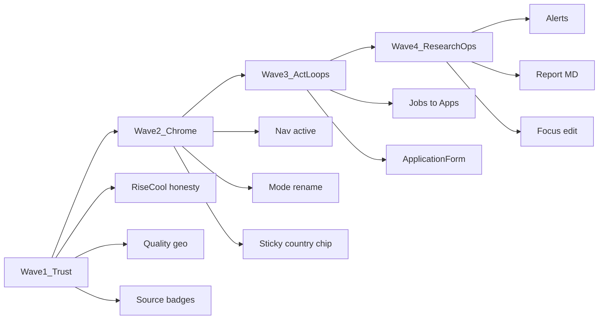

# UX/UI platform scan — Freelance Market Intelligence

**Date:** 2026-10-21  
**Method:** 7 parallel section audits (code + browser IT where available). No product code changed.  
**Verdict:** Platform is usable for power users / ops; Decision / Clarity / Load scores cluster **~2.2–2.9 / 5**. Biggest blockers are **signal honesty** (rise %, quality under geo filter), **chrome IA** (16 routes, dual modes, sticky countries), and **broken act loops** (jobs→application, weekly report/alerts).

## Zone scorecards (approx.)

| Zone | Agent | Score | Headline |
|------|-------|-------|----------|
| Explore Core | [Explore Core](515f6e81-9cc0-472c-ab0d-24e15df384c0) | Exec 3/3/2 · Trend 3/2/3 · Scan 2/4/3 | RiseCool % misleading; nav load |
| Explore Analytics | [Explore Analytics](7b069cf8-5571-4a3e-b9fb-747cf8dfe613) | ~2.4–2.9 | Skills ≠ gap; empty IT opaque |
| Explore Search | [Explore Search](78674174-bbc1-4eae-b281-77be8b8e709e) | ~2.9 | Explorer vs Jobs duplicate |
| Jobs Persona | [Jobs Persona](b5587c34-5a14-4a0b-99ae-f1cf4cbd652f) | ~2.2 | Scan→act broken; apps a11y/EN |
| Ops Trust | [Ops Trust](4861c2d0-bbc3-4602-92ca-da8e6f56883f) | ~2.3 | Quality geo-collapsed; alerts dead |
| Research Loop | [Research Loop](80c24361-02c4-400a-88fb-3206dc00c81e) | ~2.9 | Report raw MD/EN; focus no edit |
| Chrome + Journey | [Chrome Journey](8476d9c0-ee46-44b0-9f74-8198b7d3891f) | ~2.4 | No active nav; dual modes; filter hide |

Positive notes: Demand Compass CTA on Executive; brief grounding `n=`; `formatDateMinute` UTC consistent on Ops; discovery vs focus copy on Scan clear.

---

## Cross-cutting themes (deduped)

1. **Sticky geo without honesty** — `countries=IT` persists; Quality shows ~27 vs ~6788 corpus; Skills/Rates empty; CountryFilter vanishes on Jobs/Sources/Explorer while prefs stay. (A1-03, A2-02/03, A5-01, A7-03/04)
2. **Chrome IA overload** — 16 equal-weight pills, no `aria-current`; Guidata/Solo trend vs Mercato/Focus/Confronta share vocabulary. (A1-02, A7-01/02)
3. **Growth % without base** — RiseCool 400–550% on thin prior; Alerts `Python=800%` without n/baseline. (A1-01, A5-05)
4. **i18n EN leak on IT** — Alerts, Report, Brief narrative, Profile/Applications, Quality disclaimer, some panels. (A4-03, A5-02/05, A6-01/05, A2-07)
5. **Duplicate / disconnected surfaces** — Explorer vs Jobs; Lens “Focus” ≠ page Focus; Skill→Focus no bridge. (A3-01, A7-06, A1-08)

---

## Ranked backlog

Effort: **S** ≤1d · **M** 1–3d · **L** >3d.  
Impl **blocked until you approve** this backlog (or a subset).

### P0 — trust / decision blockers

| ID | Theme | Effort | Fix (UX) |
|----|-------|--------|----------|
| **P0-1** | RiseCool % without recent\|previous\|n; empty cooling @30d | M | Chips under bars; fragile-base badge; explicit empty cooling (A1-01) |
| **P0-2** | Quality corpus collapsed by country filter | M | Corpus-global default on Quality **or** sticky chip “Filtro IT · n=…” + CTA Tutti i paesi; never present geo-slice as DB health (A5-01, A1-03) |
| **P0-3** | Dual source-status vocabularies | M | One badge system (ACTIVE / NEEDS_CREDENTIALS / …) on Quality + Sources (A5-03) |
| **P0-4** | Alerts unusable for weekly watch | L | Localize; show n/baseline/threshold; severity + agenda empty state (A5-05) |
| **P0-5** | Skills page ≠ skill-gap vs demand | L | Reframe as co-occurrence / taxonomy **or** ship true gap vs focus stack (A2-01) |
| **P0-6** | Jobs scan→act: external link only | M | Log candidatura / deep-link to Applications from job card (A4-01) |
| **P0-7** | ApplicationForm a11y + EN + hard reload | M | Labels, IT copy, soft refresh (A4-02) |

### P1 — clarity / journey

| ID | Theme | Effort | Fix (UX) |
|----|-------|--------|----------|
| **P1-1** | Nav: active state + reduce surface | M | `aria-current`; primary Compass cluster; collapse Ops/Research (A1-02, A7-01) |
| **P1-2** | Rename dual modes | S | e.g. “Dettaglio metodologico” vs “Lente dati”; stop sharing “Focus/trend” words (A7-02) |
| **P1-3** | CountryFilter path-dependent | M | Always-visible sticky chip when prefs set, even on Jobs/Sources/Explorer (A7-03) |
| **P1-4** | Trends vs Executive tech-focus mismatch | S | Align: prefs = highlight, not hard filter on market (A1-04) |
| **P1-5** | Coverage banner on Trends (+ compare n) | S | Reuse MarketCoverageBanner (A1-05) |
| **P1-6** | Executive CTA order → Compass first | S | Trend / Confronta / Scan before Assistant (A1-06) |
| **P1-7** | Charts a11y | M | describedby / table progressive; i18n “thin”; aria-busy skeleton (A1-07) |
| **P1-8** | Scan → Executive bridge | S | Sticky footer after sync (A1-08) |
| **P1-9** | Empty IT Skills/Rates packaging | M | Honest empty: “0 pairs under IT · widen countries” (A2-02, A2-04) |
| **P1-10** | Explorer vs Jobs IA | M | Merge or clear roles + facet parity (A3-01, A3-05) |
| **P1-11** | Draft filters / dual intent picker on Explorer | S | Apply-on-change or clear “Bozza”; one intent control (A3-02/03) |
| **P1-12** | Profile/Applications i18n | M | Wire locale strings (A4-03) |
| **P1-13** | Compatible jobs + skill gaps → act CTA | S | Link to filtered Jobs (A4-04/05) |
| **P1-14** | Quality EN disclaimer override | S | Prefer localized subtitle; show API disclaimer as secondary (A5-02) |
| **P1-15** | Sources weekly triage | L | Surface “ACTIVE no insert / failed / stale” first (A5-04) |
| **P1-16** | Report: i18n + Markdown render | M | Locale copy + MD component; drop debug LLM line from hero (A6-01/02) |
| **P1-17** | Focus: edit intents + density | M | Parity with Discovery Modifica; filter/chips for countries (A6-03/04) |
| **P1-18** | Brief copy product (not API jargon) | M | Localize narrative/limits; hide raw POST paths (A6-05) |
| **P1-19** | Journey bridges Skill→Focus, watch empty CTA | S | Cross-links + empty-state actions (A6-07, A7-06) |

### P2 — polish

| ID | Theme | Effort |
|----|-------|--------|
| P2-1 | Rates unknown + mixed units packaging (A2-05/06) | M |
| P2-2 | Analytics panels EN + charts (A2-07) | M |
| P2-3 | A11y alert/sort Skills (A2-08) | S |
| P2-4 | Explorer cap 50 + pagination; lens ≠ LensToggle (A3-06/07) | M |
| P2-5 | Jobs filters outline / Enter apply; empty pipeline CTA (A4-07/08) | S |
| P2-6 | Date consistency Jobs vs Apps (A4-06) | S |
| P2-7 | Catalog max 80 + Evaluate alerts a11y (A5-06/07) | S |
| P2-8 | ProposeSection labels + human summary vs JSON (A6-06) | M |
| P2-9 | Prefs: locale race; hide-nav journey risk; expose view_mode (A7-05/08) | M |
| P2-10 | Solo trend explain what hides (A7-07) | S |

---

## Suggested implementation waves (after approval)

1. **Wave 1 — Trust:** P0-1, P0-2, P0-3, P1-4, P1-5, P1-14  
2. **Wave 2 — Chrome:** P1-1, P1-2, P1-3, P1-6  
3. **Wave 3 — Act loops:** P0-6, P0-7, P1-12, P1-13  
4. **Wave 4 — Research / Ops weekly:** P0-4, P1-15, P1-16–18, P0-5 (or defer P0-5 as product reframe)

---

## Out of scope this scan

- Backend geo backfill / seed focus (already shipping separately)  
- New collectors / Demand Compass data model  
- Visual rebrand / design-system overhaul  

## Sources

Agent store notes under session `ux-scan/` (A1–A7). Full finding IDs preserved for traceability.
